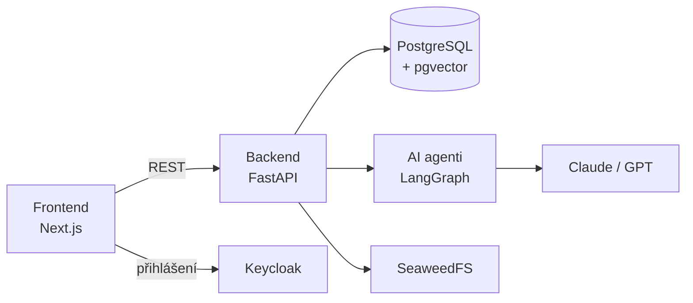

<div align="center">


# Praktik-AI

**Platforma, kde AI pomáhá kurzy tvořit, studovat i hodnotit.**

[](https://github.com/markuss23/praktik-ai/actions/workflows/check_backend_lint.yml)
[](LICENSE)


[English](README.md) · **Čeština**

[Wiki](https://github.com/markuss23/praktik-ai/wiki) · [Architektura](docs/architecture.md) · [Přispívání](CONTRIBUTING.md)

</div>

---

Praktik-AI rozvíjí AI kompetence akademických pracovníků pedagogických fakult. Lektor nahraje podklady a AI z nich navrhne kurz. Student ho prochází s AI mentorem a AI ho i hodnotí.

## Co umí

- **AI tvorba kurzů:** z nahraných materiálů vznikne plán kurzu, moduly a obrázky. Lektor je pak upraví v editoru.
- **AI mentor:** chatbot, který odpovídá z obsahu modulu nebo celého kurzu (RAG nad pgvectorem).
- **Testy s AI:** pět formátů od uzavřených otázek po sokratovský dialog. Otevřené odpovědi hodnotí AI. [Formáty testů](backend/api/src/assessments/README.md)
- **Schvalování:** kurz před zveřejněním zkontroluje a schválí garant. [Životní cyklus kurzu](backend/api/src/courses/README.md)
- **Veřejná databáze materiálů:** sdílení výukových materiálů s recenzí, hodnocením, forky a sbírkami. [Dokumentace knihovny](backend/api/src/publicDB/README.md)
- **Tickety:** student nahlásí problém nebo dotaz k modulu, kurzu či materiálu a odpoví mu autor nebo garant. [Dokumentace ticketů](backend/api/src/tickets/README.md)
- **Pod kontrolou:** prompty a modely agentů mění superadmin v administraci a spotřeba tokenů se počítá a dá se omezit.

## Rychlý start

Potřebuješ Docker s Compose v2 a API klíč k Anthropic (a OpenAI kvůli embeddingům).

```bash
git clone https://github.com/markuss23/praktik-ai.git
cd praktik-ai
cp .env_example .env     # doplň ANTHROPIC_API_KEY a OPENAI_API_KEY
docker compose up -d --build
```

| Služba | URL |
| --- | --- |
| Aplikace | <http://localhost:3000> |
| API + Swagger UI | <http://localhost:8000> |
| Keycloak admin | <http://localhost:8080> |

Funguje to, když <http://localhost:8000/health> vrátí `{"message": "ok"}` a na <http://localhost:3000> se dá přihlásit.

Dev realm obsahuje testovací účty (heslo = jméno):

| Účet | Role | Co si vyzkoušíš |
| --- | --- | --- |
| `student` | `user` | zápis do kurzu a studium |
| `lektor` | `lector` | tvorba kurzu s AI |
| `garant` | `guarantor` | schvalování kurzů |
| `admin` | `superadmin` | nastavení agentů, uživatelé, číselníky |

Realm se importuje jen při prvním startu Keycloaku. Pokud už běžel, účty chybí: smaž schéma `keycloak` v DB, nebo roli přiděl ručně v [Keycloak adminu](http://localhost:8080) (realm `praktikai-dev` → Users → Role mapping).

Všechny proměnné prostředí: [docs/configuration.md](docs/configuration.md).

## Jak to funguje



**Stack:** Next.js 15 · FastAPI · PostgreSQL 18 + pgvector · LangGraph · Keycloak · SeaweedFS · Docker Compose

Podrobně v [docs/architecture.md](docs/architecture.md).

## Dokumentace

| Pro koho | Kde |
| --- | --- |
| Uživatelé | [GitHub wiki](https://github.com/markuss23/praktik-ai/wiki) |
| Vývojáři | [CONTRIBUTING.md](CONTRIBUTING.md): vývoj, migrace, lint, CI |
| Architektura | [docs/architecture.md](docs/architecture.md): služby, role, struktura |
| Moduly | README vedle kódu, přehled v [CONTRIBUTING.md](CONTRIBUTING.md#dokumentace-modulů) |

## Přispívání

Větev z `dev`, PR do `dev`. Postup v [CONTRIBUTING.md](CONTRIBUTING.md). Bezpečnostní chyby hlas soukromě, viz [SECURITY.md](SECURITY.md).

## Partneři

<p>
  &nbsp;&nbsp;
  &nbsp;&nbsp;
  
</p>

## Licence

[MIT](LICENSE)
