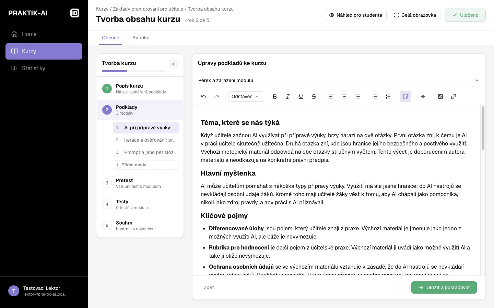
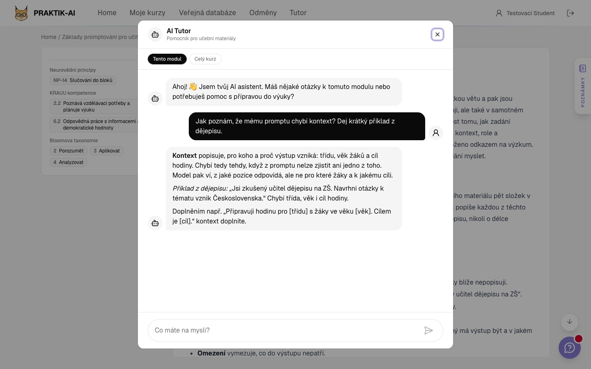
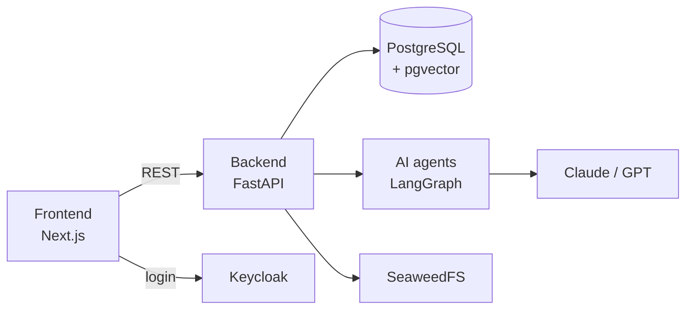

<div align="center">


# Praktik-AI

**A learning platform where AI helps create, study and assess courses.**

[](https://github.com/markuss23/praktik-ai/actions/workflows/check_backend_lint.yml)
[](LICENSE)


**English** · [Čeština](README.cs.md)

[Wiki](https://github.com/markuss23/praktik-ai/wiki) · [Architecture](docs/architecture.md) · [Contributing](CONTRIBUTING.md)

</div>

---

Praktik-AI prepares future teachers for working with AI. It brings courses, an AI tutor and a public library of teaching materials together in one place, for student teachers and the faculty who teach them. A teacher uploads source materials and AI drafts a course from them; students go through it with an AI mentor that also gives them feedback.


> The app UI and the developer docs are in Czech.

## Features

- **AI course authoring:** uploaded materials turn into a course plan, modules and cover images. The lecturer then edits them.
- **AI mentor:** a chatbot that answers from the content of a module or a whole course (RAG on pgvector).
- **AI-graded tests:** five formats, from multiple choice to a Socratic dialogue. AI grades open answers. [Test formats](backend/api/src/assessments/README.md)
- **Review workflow:** a guarantor reviews and approves every course before it goes public. [Course workflow](backend/api/src/courses/README.md)
- **Public resource library:** share teaching materials with reviews, ratings, forks and collections. [Library docs](backend/api/src/publicDB/README.md)
- **Tickets:** students report issues or ask questions about a module, course or material, and the author or guarantor replies. [Ticket docs](backend/api/src/tickets/README.md)
- **Under control:** a superadmin edits agent prompts and models in the admin UI and token usage is tracked and can be capped.

|  |  |
| --- | --- |
| The lecturer edits a course AI drafted from uploaded materials | A student asks the AI mentor, which answers from the module content |

## Quick start

You need Docker with Compose v2 and an Anthropic API key (OpenAI for embeddings).

```bash
git clone https://github.com/markuss23/praktik-ai.git
cd praktik-ai
cp .env_example .env     # fill in ANTHROPIC_API_KEY and OPENAI_API_KEY
docker compose up -d --build
```

| Service | URL |
| --- | --- |
| App | <http://localhost:3000> |
| API + Swagger UI | <http://localhost:8000> |
| Keycloak admin | <http://localhost:8080> |

It works when <http://localhost:8000/health> returns `{"message": "ok"}` and you can log in at <http://localhost:3000>.

The dev realm ships with test accounts (password = username):

| Account | Role | Try out |
| --- | --- | --- |
| `student` | `user` | enrolling and studying |
| `lektor` | `lector` | creating a course with AI |
| `garant` | `guarantor` | approving courses |
| `admin` | `superadmin` | agent settings, users, catalogs |

The realm is imported only on Keycloak's first start. If it ran before, the accounts are missing: drop the `keycloak` schema in the DB, or assign the role by hand in the [Keycloak admin](http://localhost:8080) (realm `praktikai-dev` → Users → Role mapping).

All environment variables: [docs/configuration.md](docs/configuration.md).

## How it works



**Stack:** Next.js 15 · FastAPI · PostgreSQL 18 + pgvector · LangGraph · Keycloak · SeaweedFS · Docker Compose

Details in [docs/architecture.md](docs/architecture.md).

## Documentation

| For | Where |
| --- | --- |
| Users | [GitHub wiki](https://github.com/markuss23/praktik-ai/wiki) |
| Developers | [CONTRIBUTING.md](CONTRIBUTING.md): dev setup, migrations, lint, CI |
| Architecture | [docs/architecture.md](docs/architecture.md): services, roles, layout |
| Modules | README next to the code, index in [CONTRIBUTING.md](CONTRIBUTING.md#dokumentace-modulů) |
| UI kit, palette & fonts | [frontend/UI-KIT.md](frontend/UI-KIT.md#paleta): components, color tokens, fonts, styling rules |

## Contributing

Branch off `dev`, open a PR to `dev`. See [CONTRIBUTING.md](CONTRIBUTING.md). Report security issues privately, see [SECURITY.md](SECURITY.md).

## Contact

Questions and feedback: [praktikai@ujep.cz](mailto:praktikai@ujep.cz). Bugs and feature requests: [GitHub issues](https://github.com/markuss23/praktik-ai/issues).

## Partners

<p>
  &nbsp;&nbsp;
  &nbsp;&nbsp;
  
</p>

## License

[MIT](LICENSE)
