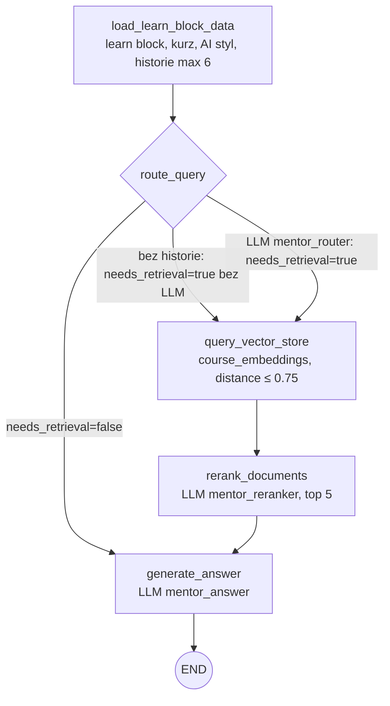
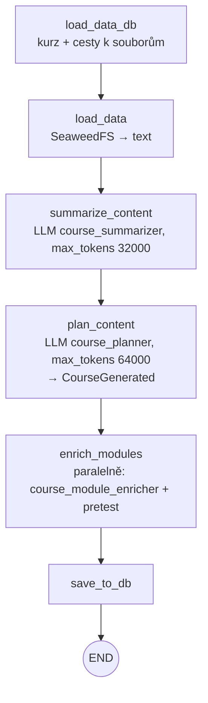

# AI agenti

LangGraph agenti pro generování kurzů, obrázků, embeddingů a pro chat s mentorem. Agent je graf uzlů nad sdíleným `state`, spouští ho tenká service třída a volá ho router v `api/src/agents/routers.py`.

## Přehled

| Agent | Co dělá | Vstup → výstup | Volá ho |
| --- | --- | --- | --- |
| `course_generator` | Z nahraných podkladů vygeneruje moduly kurzu. | `course_id` → moduly, learn blocky, číselníky, pretesty v DB | `POST /agents/generate-course` (background task) |
| `mentor` | RAG chat nad obsahem kurzu. | otázka + `learn_block_id`/`course_id` → HTML odpověď | `POST /agents/learn-blocks-chat` |
| `embedding_generator` | Rozseká learn blocky na chunky a uloží embeddingy. | `course_id` → řádky v kolekci `course_embeddings` | `POST /agents/generate-course-embeddings` |
| `image_generator/course` | Vygeneruje cover kurzu. | `course_id` → 1280×720 WebP v SeaweedFS, nastaví se kurzu | `POST /agents/generate-course-images` (background task) |
| `image_generator/module` | Vygeneruje obrázek modulu. | `module_id` → `module-images/<id>/image.<ext>` v SeaweedFS | `POST /agents/generate-module-images` (background task) |
| `wiki/agent` | Stáhne GitHub wiki a zaindexuje ji. | repo z `settings.wiki` → kolekce `wiki_embeddings` | APScheduler (`wiki/agent/scheduler.py`), `POST /agents/wiki-sync` (superadmin) |
| `wiki/mentor` | RAG chat nad wiki. | otázka → odpověď | `POST /agents/wiki-chat` (bez přihlášení) |
| `open_question_evaluator` | Vyhodnotí odpověď na otevřenou otázku. Není to graf, jen jedno LLM volání. | otázka + odpověď → `is_correct`, `feedback` | `api/src/assessments/pretest/service.py` |

Formáty `*_ai` mají vlastní agenty ve své složce: [`closed_questions_ai`](../api/src/assessments/closed_questions_ai/README.md), [`open_question_ai`](../api/src/assessments/open_question_ai/README.md), [`socratic_dialog_ai`](../api/src/assessments/socratic_dialog_ai/README.md). Generátor otázek pretestu je v [`pretest`](../api/src/assessments/pretest/README.md).

## Výběr modelu a prompty

Model i prompt se čtou z tabulky `system_setting` podle `key` přes `get_llm_config(db, key)` v `base/llm.py`. Bere se jen řádek s `is_active = true`. Když řádek chybí a nejsou zadané `default_model`/`default_prompt`, vyhodí `ValueError`.

`create_chat_llm(model)` vybere třídu podle názvu modelu:

| Model začíná | Třída | Poznámka |
| --- | --- | --- |
| `claude` | `ChatAnthropic` | `temperature` se nikdy nepředává. `max_tokens` je vždy explicitně, default 16000. Nad 16000 se zapne `streaming`. |
| cokoliv jiného | `ChatOpenAI` | `temperature` se předá, pokud je zadaná. |

Každá instance dostane `UsageCallback`, který zapisuje spotřebu tokenů (viz níže).

Kde jsou prompty:

| Klíč | Prompt | Default v kódu |
| --- | --- | --- |
| `course_summarizer`, `course_planner`, `course_module_enricher`, `open_question_evaluator` | `system_setting.prompt` | ne |
| `mentor_router`, `mentor_reranker`, `mentor_answer` | soubory `mentor/*.md`, sloupec `prompt` je prázdný a nečte se | ne (model musí být v DB) |
| `image_generator_prompt`, `module_image_generator_prompt` | `system_setting.prompt`, ale v seedu nejsou | `claude-sonnet-5` + `render_system_prompt(...)` |
| `image_generator_model` | jen sloupec `model` (OpenAI image model) | `gpt-image-2` |
| `wiki_mentor_answer` | `system_setting.prompt`, v seedu není | `gpt-4o-mini` + `DEFAULT_PROMPT` |

Výchozí hodnoty jsou v `SYSTEM_SETTINGS` v `api/seed.py`. `seed_db()` je vloží jen do prázdné tabulky. Změny v seedu se do existující DB propíšou skriptem:

```bash
cd backend
python -m scripts.update_system_settings                 # všechny klíče
python -m scripts.update_system_settings course_planner  # jen vybrané
```

Skript přepíše `name`, `model`, `prompt`, `description`. Ruční úpravy z adminu se ztratí. Superadmin mění nastavení přes `GET /superadmin/settings` a `PUT /superadmin/settings/{setting_id}`.

Embeddingy jsou napevno `text-embedding-3-large` (`vector_store.py`, `wiki/vector_store.py`). Převod souborů v `base/loaders/base.py` volá napevno `gpt-4o-transcribe` (audio/video) a `gpt-4o` (popis obrázků v MarkItDown).

## Mentor (RAG)



- **load_learn_block_data**: historie se nemíchá. `scope=module` bere logy jen z daného learn blocku, `scope=course` jen course chat. `use_history=false` historii vypne.
- **route_query**: structured output `RouteDecision`. Přepíše navazující otázku („a proč?“) na samostatnou do `search_query`. Při chybě LLM se hledá s původní zprávou.
- **query_vector_store**: `scope=module` filtruje `course_id` + `module_id`, `k=10`. `scope=course` jen `course_id`, `k=20`. Chunky nad `MAX_DISTANCE = 0.75` se zahodí.
- **rerank_documents**: při ≤ 5 chuncích se přeskočí. LLM vrátí čísla oddělená čárkou. Při chybě se vezme prvních 5.
- **generate_answer**: kontext = chunky. Když nejsou, použije se text learn blocku (max 4000 znaků). Když není ani ten a router řekl „stačí historie“, odpovídá z konverzace. Jinak vrátí pevnou omluvu bez volání LLM. Délka odpovědi podle AI stylu: `dens.low` 250, `dens.med` 500, `dens.high` 1000 znaků, default 500.

Router po odpovědi uloží dotaz a odpověď do `mentor_interaction_log`. Chat jde jen v aktivním kurzu se stavem `approved` nebo `archived` a vyžaduje zápis (vlastník a superadmin ne).

## Course generator



- Běží jako `asyncio` task s vlastní DB session. Průběh je v tabulce `course_generation_progress` (`api/src/agents/progress.py`), 5 kroků, frontend ho polluje přes `GET /agents/course-progress/{course_id}`. `plan_content` i `enrich_modules` hlásí krok 4.
- Spustit jde jen kurz ve stavu `draft` nebo `failed`. Při chybě se kurz přepne na `failed`.
- `load_data` převádí soubory přes `file_to_text`. Soubor, který selže, se přeskočí. Selžou-li všechny, generování spadne.
- `plan_content` vrací pro každý modul `title`, `perex`, `content` (HTML). Jiný počet modulů než `modules_count_ai_generated` je jen warning.
- `enrich_modules` určí kódy NP, KRAUU a Bloom a vygeneruje pretest (`api/src/assessments/pretest/generator.py`).
- `save_to_db` založí `Module`, jeden `LearnBlock`, vazby na číselníky a povinný `CourseAssessment` typu `pretest`. Neznámý NP kód → fallback `NP-01`. Žádné platné KRAUU/Bloom → převezmou se z kurzu. Kurz dostane `status="generated"` a `summary`.

## Spotřeba a limity

- Každé volání LLM z `create_chat_llm` zapíše řádek do `ai_usage` (`user_id`, `endpoint`, `model`, `input_tokens`, `output_tokens`). Dělá to `UsageCallback` v `base/usage.py`.
- Komu se tokeny připíšou, určuje `ContextVar` `usage_context`. Nastavuje ho dependency `ai_budget` v `api/dependencies.py`. Background tasky z `asyncio.create_task` ho zdědí.
- `ai_budget` je na routerech `agents` a `assessments` (`api/src/routers.py`). Veřejný `wiki-chat` a scheduler ho nemají, zapisují s `user_id = NULL`.
- Limit: env `AI_DAILY_TOKEN_LIMIT` (`settings.ai_daily_token_limit`), default `0` = vypnuto, jen se sbírá.
- Limit platí jen pro roli `user` a jen pro jiné metody než `GET`. Sčítá `input + output` za posledních 24 h (klouzavé okno). Při překročení vrátí 429 „Vyčerpali jste denní limit AI.“

## Jak přidat agenta

1. Založ složku `agents/<nazev>/` se `state.py` (`TypedDict`), `nodes/`, `graph.py` (`create_graph()`) a `service.py`.
2. LLM vytvářej jen přes `get_llm_config(db, "<klic>")` a `create_chat_llm(cfg.model)`. Jinak se tokeny nezapočítají.
3. Přidej klíč do `SYSTEM_SETTINGS` v `api/seed.py` a do existujících DB ho dostaň přes `python -m scripts.update_system_settings <klic>`. Nebo dej v kódu `default_model`/`default_prompt`.
4. Přidej endpoint do `api/src/agents/routers.py`. Router `agents` má `ai_budget` automaticky.
5. Dlouhý běh dej do background tasku s vlastní `SessionLocal()` a průběhem jako u kurzu nebo obrázků.
6. Agent pro hodnoticí formát patří do `api/src/assessments/<format>/agents/`, ne sem.

## Soubory

| Soubor | Obsah |
| --- | --- |
| `base/llm.py` | `get_llm_config`, `create_chat_llm` |
| `base/usage.py` | `UsageCallback`, `usage_context` |
| `base/loaders/` | `file_to_text` (MarkItDown, přepis audia), `MarkdownLoader` |
| `vector_store.py` | PGVector singleton, kolekce `course_embeddings` |
| `course_generator/` | graf generování kurzu, `input_block.py` = společný vstupní blok promptů |
| `mentor/` | RAG graf, prompty `prompt.md`, `router_prompt.md`, `reranker_prompt.md` |
| `embedding_generator/` | `load_course_data` → `generate_embeddings` |
| `image_generator/` | společný graf `load_context` → `build_prompt` → `generate_image`; `course/` a `module/` dodají kontext a prompt; `prompt_template.py` = pevný styl |
| `wiki/agent/` | `clone_or_pull_wiki` → `load_pages` → `generate_embeddings`, scheduler |
| `wiki/mentor/` | `query_vector_store` → `generate_answer` |
| `open_question_evaluator.py` | bezstavové vyhodnocení otevřené otázky |
| `../api/src/agents/` | router, schémata, trackery průběhu (`progress.py` v DB, `image_progress.py` v paměti) |

## Pozor na

- Prompty mentora jsou v `.md` souborech. Úprava `prompt` u `mentor_*` v adminu nic nezmění, mění se jen model.
- `get_llm_config` bez defaultů spadne, když klíč v DB chybí (`course_*`, `mentor_*`, `open_question_evaluator`).
- Generování obrázku volá OpenAI Images API přímo (`clients/openai_client.py`). Image model musí začínat `gpt-image` nebo být `chatgpt-image-latest`. Tyto tokeny se do `ai_usage` nezapisují, stejně jako embeddingy a `file_to_text`.
- `enrich_modules` volá LLM v `ThreadPoolExecutor`. Ten `ContextVar` nepřenáší, takže tyto tokeny se zapíšou s `user_id = NULL`.
- `embedding_generator` jde jen pro kurz ve stavu `approved`. Nejdřív smaže staré chunky kurzu, pak vkládá nové. Není to jedna transakce.
- Wiki indexace staré chunky nemaže. ID je `<název stránky>_<index>`, takže zkrácená nebo smazaná stránka nechá v indexu staré chunky.
- `image_progress.py` drží stav v paměti procesu. Po restartu nebo na jiném workeru průběh není vidět.
- `course_generator/__main__.py` je nefunkční pozůstatek. Volá graf bez `course_id` a `db`.
