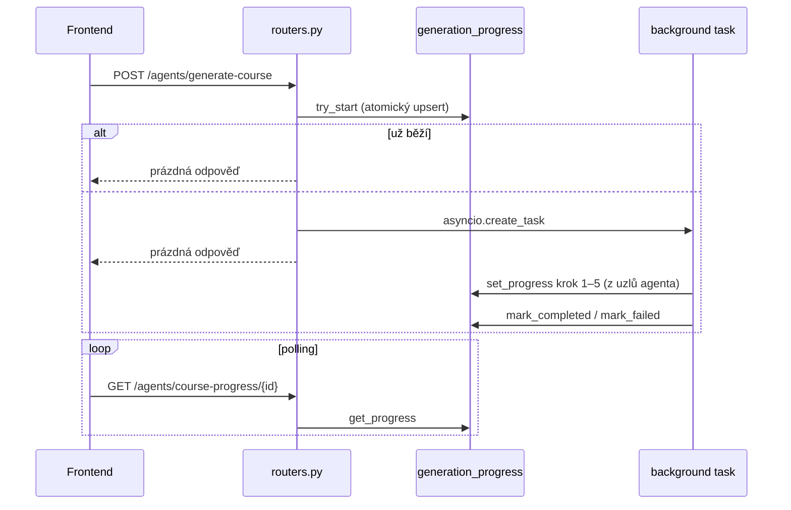

# AI endpointy (`agents`)

HTTP vrstva, která spouští LangGraph agenty z `backend/agents`. Řeší oprávnění, stav kurzu, běh na pozadí a průběh pro polling. Samotné agenty (uzly, prompty, modely) popisuje [backend/agents/README.md](../../../agents/README.md).

## Pojmy

| Pojem | Význam |
| --- | --- |
| `router` | Endpointy s přihlášením. V `src/routers.py` má navíc dependency `ai_budget`. |
| `public_router` | Jen wiki chat. Bez přihlášení a bez `ai_budget`. |
| Background task | `asyncio.create_task` ve stejném procesu. Request se vrátí hned, task si otevře vlastní `SessionLocal()`. |
| Progress | Tabulka `generation_progress` (`progress.py`), sdílená mezi workery gunicornu. Klíč `course:<id>` (kurz), `course-image:<id>`, `module-image:<id>` (obrázky), `module-podcast:<id>` (podcast). |
| Heartbeat | `run_tracked` obnovuje `updated_at` běžícího tasku každou minutu (`HEARTBEAT`). |
| `STALE_AFTER` | 3 minuty. Řádek `running` bez aktualizace déle než tohle se bere jako mrtvý. |
| `ai_budget` | Denní limit tokenů pro roli `user` (`dependencies.py`), viz [Pravidla](#pravidla). |

## Skupiny endpointů

| Skupina | Agent | Jak běží | Průběh |
| --- | --- | --- | --- |
| Generování kurzu | `course_generator` | background task | `GET /agents/course-progress/{id}` (DB) |
| Cover kurzu, obrázek modulu | `image_generator/course`, `image_generator/module` | background task | `GET /agents/course-image-progress/{id}`, `module-image-progress/{id}` (DB) |
| Podcast modulu | `podcast_generator` | background task | `GET /agents/module-podcast-progress/{id}` (DB) |
| Embeddingy kurzu | `embedding_generator` | synchronně v requestu | – |
| Mentor chat | `mentor` | synchronně, po odpovědi zápis do `mentor_interaction_log` | – |
| Wiki chat, wiki sync | `wiki/mentor`, `wiki/agent` | synchronně | – |

`/agents/active-course-generations` a `/agents/active-image-generations` vrací běžící generování, ať frontend po refreshi obnoví polling. Superadmin vidí všechna, ostatní jen u svých kurzů.

## Tok

Obrázky jdou stejně, jen s vlastním klíčem a výsledek (cesta v SeaweedFS…) je ve sloupci `result`. Kroky obrázku: 1 kontext z DB, 2 prompt (LLM), 3 image model, 4 uložení do SeaweedFS.

## Oprávnění

| Akce | Role | Další kontrola |
| --- | --- | --- |
| Generování kurzu, embeddingy, obrázky, podcast, jejich progress | `lector` | `validate_owner_or_superadmin`. Garant k cizímu kurzu nesmí. |
| Mentor chat | přihlášený | `check_enrollment(bypass_for_owner=True)`. Vlastník a superadmin bez zápisu, ostatní musí být zapsaní. |
| Wiki chat | kdokoliv | – |
| Wiki sync | `superadmin` | – |

## Pravidla

- Generování kurzu jen ze stavu `draft` nebo `failed`. Při chybě: `mark_failed`, rollback a `course.status = failed`. Stav `generated` nastavuje agent (`save_to_db`).
- Druhé spuštění, když generování běží, nic nespustí. Kurz vrátí stejnou odpověď (jen `title`), obrázek aktuální průběh. Platí napříč workery (`try_start`), pro kurz i obrázky.
- Cover kurzu: `assert_course_editable` před spuštěním i znovu před uložením. Kurz mezitím odeslaný ke schválení obrázek nepřepíše. Obrázek projde `normalize_course_image` (1280×720 WebP) a nastaví se kurzu.
- Obrázek modulu se uloží do `module-images/<id>/image.<ext>` a opakované generování ho přepíše.
- Podcast modulu: `assert_course_editable` před spuštěním i před uložením. WAV jde do `module-podcasts/<id>/podcast.wav` (přepíše se), cesta a přepis do `module.podcast_path` / `podcast_transcript`. Stažení jako soubor `<název modulu>.wav` přes `GET /modules/{id}/podcast` (viz [`modules`](../modules/README.md)). Modul bez obsahu learn blocku = `failed`.
- Embeddingy jen pro kurz ve stavu `approved`.
- Mentor chat jen v aktivním kurzu ve stavu `approved` nebo `archived`. `scope=module` potřebuje `learn_block_id`, `scope=course` stačí `course_id`. Learn block z jiného kurzu = 400.
- `ai_budget` nastaví `usage_context` (komu se připíšou tokeny). Limit `settings.ai_daily_token_limit` za posledních 24 h platí jen pro roli `user` a ne pro `GET`. `0` = vypnuto. Překročení = 429.
- Chyby: background task chytá všechno a zapíše text chyby do progressu (`status = failed`, `error`). Synchronní endpointy výjimky nechytají, skončí v globálním handleru jako 500 „Nečekávaná chyba serveru“.

## Soubory

| Soubor | Co dělá |
| --- | --- |
| `routers.py` | Všechny endpointy, background tasky `_run_course_generation`, `_run_image_generation`, uložení obrázků. |
| `progress.py` | DB tracker generování kurzu, obrázků a podcastu, heartbeat (`run_tracked`). `set_progress` volají uzly v `agents/course_generator/nodes/`, `agents/image_generator/nodes/` a `agents/podcast_generator/nodes.py`. |
| `schemas.py` | Request/response modely. |
| `typing_guard.py` | `typed_too_fast`: kontrola rychlosti psaní odpovědí v testech. S agenty nesouvisí, používá ho `assessments/controllers.py`. |

## Pozor na

- Background task žije v procesu. Když worker spadne, řádek zůstane `running` až 3 minuty a kurz zůstane v `draft`. Pak jde spustit znovu.
- Obrázek modulu nemá kontrolu editovatelnosti kurzu a cesta se nikam do DB neukládá. V API ho nic neservíruje.
- Wiki chat je veřejný a bez `ai_budget`. Tokeny se zapíšou s `user_id = NULL` a žádný limit neplatí.
- Podcast se po úpravě obsahu modulu sám nepřegeneruje. Hlas se do `ai_usage` zapíše jedním řádkem za celý podcast, jen když se povedou všechny repliky. Spálené tokeny nepovedeného běhu se nezapíšou. `/agents/active-*-generations` podcast nevrací.
- Embeddingy a wiki sync běží v requestu. U velkého kurzu může request trvat dlouho.
