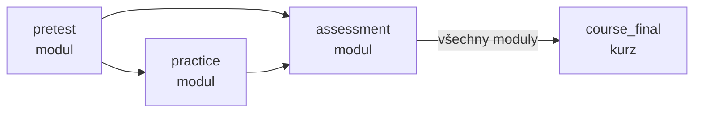
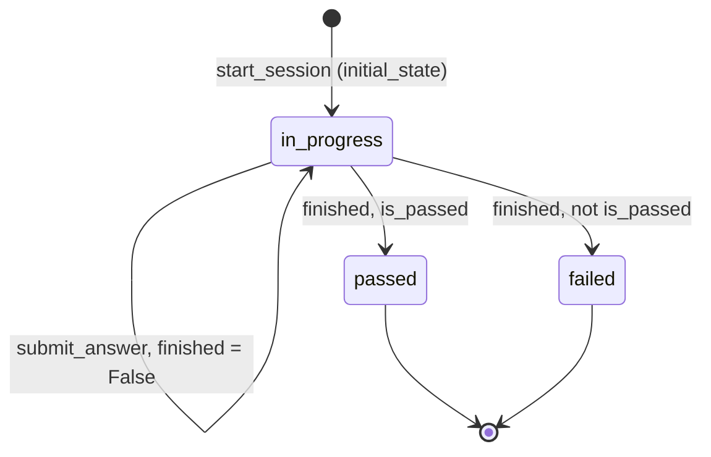

# Assessments

Modul pro testy a procvičování v kurzu. Lektor připojí ke kurzu interakční formát, student ho projde v session a výsledek odemyká další části kurzu.

## Pojmy

| Pojem | Kde | Význam |
| --- | --- | --- |
| Formát | `assessment_type` (`models.py`), složka formátu | Druh testu, např. `closed_questions`. Katalog plní `seed.py`. |
| Konfigurace | `course_assessment` | Formát připojený ke kurzu nebo modulu v jednom kontextu. Nese `settings`, `is_enabled`, `is_required`. |
| Kontext | `AssessmentContext` (`enums.py`) | Kde je formát nasazený: `pretest`, `practice`, `assessment`, `course_final`. |
| Session | `assessment_session` | Jeden běh studenta na jedné konfiguraci. |
| `settings` | `course_assessment.settings` (JSONB) | Zadání testu. Schéma je `Settings` formátu. |
| `state` | `assessment_session.state` (JSONB) | Pozice studenta v běhu. Schéma je `State` formátu. |
| Gate | `PREREQUISITES` (`controllers.py`) | Pravidlo, které kontext musí být splněný, než jde spustit další. |
| Outcome | `AnswerOutcome` (`outcome.py`) | Co vrátí formát po vyhodnocení odpovědi. |

## Tok

Pořadí kontextů. Šipka = gate. Platí jen pro konfigurace s `is_required`, `is_enabled` a `is_active`.

Životní cyklus session:

`start_session` (`controllers.py`) kontroluje v tomto pořadí:

1. Konfigurace podle `course_id` / `context` / `module_id` / `assessment_type_code`. Žádná = 404, víc než jedna = 400.
2. Zápis v kurzu (`check_enrollment`), jinak 403.
3. Rozjetá session existuje → vrátí ji. Nic dalšího se nekontroluje.
4. Kurz je aktivní, publikovaný a schválený (`assert_course_open_for_students`), jinak 400.
5. `is_enabled`, jinak 403.
6. Gate (`assert_prerequisites_passed`), jinak 403.
7. `fmt.initial_state` a uložení nové session.

`submit_answer` zavolá `fmt.evaluate_answer` a uloží nový `state`. Při `finished` zapíše `score`, `is_passed`, `status` a `finished_at`. Při `is_passed` zkusí dokončit kurz (`mark_course_completed`).

## Pravidla

- Student má na jedné konfiguraci nejvýš jednu rozjetou session (`in_progress` nebo `awaiting_review`). Hlídá to `find_active_session` i unikátní index `uq_assessment_session_user_in_progress`.
- Po `passed` nebo `failed` může student spustit novou session. Počet opakování není omezený.
- Gate u modulového kontextu hledá povinné konfigurace ve stejném modulu. U `course_final` (`module_id = NULL`) napříč celým kurzem, ale jen v kontextu `assessment`.
- Splněno = existuje session ve stavu `passed`. Stačí jedna, i starší.
- Bez povinných konfigurací v nižším kontextu gate pustí dál.
- Gate se kontroluje jen při zakládání session. Rozjetou session vypnutí formátu ani zavření kurzu nezastaví.
- `score` je 0–100, `is_passed` určuje formát. Ukládá se jen při dokončení (`controllers.submit_answer`).
- Modul je hotový, když má `passed` všechny povinné zapnuté konfigurace. Kurz je hotový, když jsou hotové všechny aktivní moduly a povinný `course_final` (`course_completion` v `utils.py`).
- `enrollment.completed_at` se nastaví jen jednou. Další průchody ho nemění.
- `course_final` má vždy `module_id = NULL`, ostatní kontexty vždy modul. Hlídá to `attach_course_assessment` i check `ck_course_assessment_context_module`.
- Kontext musí být v `assessment_type.allowed_contexts`, jinak 400.
- Konfigurace jde měnit jen u kurzu ve stavu draft / generated / edited (`assert_course_editable`).
- Odpojení je soft delete. Sessions studentů zůstávají a historie je ukazuje dál.
- Pretest nejde přes obecné PUT ani DELETE (`assert_not_pretest`, 400). Jeho otázky se mění vlastním endpointem.
- `settings` se čte živě z konfigurace. Session nemá snapshot, kopíruje si jen to, co formát dá do `state`.
- Před každým zápisem `settings` projde `parse_settings` (`utils.py`). Chyba = 422.

## Formáty

| Formát | README | Kontexty (`seed.py`) | AI |
| --- | --- | --- | --- |
| `pretest` | [pretest](pretest/README.md) | `pretest` | hodnocení otevřené otázky |
| `closed_questions` | [closed_questions](closed_questions/README.md) | `practice`, `assessment`, `course_final` | ne |
| `closed_questions_ai` | [closed_questions_ai](closed_questions_ai/README.md) | `practice`, `assessment`, `course_final` | generování otázek |
| `open_question_ai` | [open_question_ai](open_question_ai/README.md) | `practice`, `assessment`, `course_final` | generování i hodnocení |
| `socratic_dialog_ai` | [socratic_dialog_ai](socratic_dialog_ai/README.md) | `practice`, `assessment`, `course_final` | celý rozhovor |

Pretest zakládá generátor kurzu ke každému modulu, vždy jako povinný (`agents/course_generator/nodes/save_to_db.py`).

## Jak přidat nový formát

1. Založ složku `src/assessments/<code>/`. Název = `assessment_type.code`.
2. V `schemas.py` napiš `Settings` (s `extra="forbid"`), `State` a model pro `view`.
3. V `service.py` napiš:
   - `async initial_state(db, user, course_assessment, cfg) -> State`
   - `view(cfg, state) -> model` s poli `question` a volitelně `options`
   - `async evaluate_answer(db, course_assessment, cfg, state, answer) -> AnswerOutcome`
4. V `__init__.py` exportuj `Settings`, `State`, `initial_state`, `view`, `evaluate_answer`. Vzor je `closed_questions/__init__.py`.
5. Píše-li student volný text, přidej `TYPED_ANSWER = True` a ukládej `last_answer` do `State`.
6. Přidej řádek do `FORMATS` v `utils.py`.
7. Přidej `Settings` do unionu `AssessmentSettings` v `schemas.py`. Pořadí rozhoduje, viz komentář nad unionem.
8. Přidej formát do `ASSESSMENT_TYPES` v `seed.py` a SQL migraci do `migrations/` (vzor `0022_assessment_type_socratic_dialog_ai.sql`).
9. Používá-li formát LLM, přidej klíč do `SYSTEM_SETTINGS` v `seed.py` a do stejné migrace. Prompt patří do `.md` ve složce formátu.
10. Napiš `README.md` formátu podle `closed_questions/README.md` a doplň řádek do tabulky výše.

## Soubory

| Soubor | Co dělá |
| --- | --- |
| `routers.py` | HTTP vrstva. Lektorské endpointy mají `require_role("lector")`. |
| `controllers.py` | Připojení a úprava konfigurací, start session, odevzdání odpovědi, historie, progress. `PREREQUISITES`. |
| `utils.py` | `FORMATS`, `get_format`, `parse_settings`, hledání konfigurace a session, gate, `course_completion`. |
| `schemas.py` | Request/response modely a union `AssessmentSettings`. |
| `outcome.py` | `AnswerOutcome`, společný výstup `evaluate_answer`. |
| `<format>/` | Implementace formátu, viz tabulka Formáty. |
| `api/models.py` | `AssessmentType`, `CourseAssessment`, `AssessmentSession`, `AssessmentTurn`. |
| `api/seed.py` | Katalog formátů a modely LLM pro prompty. |

## Pozor na

- `seed.py` vkládá jen chybějící kódy formátů. Změna defaultů v `Settings` se do existující DB nepropíše, je potřeba migrace.
- Union `AssessmentSettings` validuje zleva doprava a vyhraje první shoda. Nový formát se samými defaulty může „spolknout“ cizí `settings`.
- `settings` bez snapshotu: když lektor změní otázky (kurz vrácený do editace), rozjeté sessions čtou nové `settings` se starým `state`.
- Chyba AI generátoru (`ValueError`) skončí jako 500 z globálního handleru v `main.py`. Session se nezaloží.
- Dva souběžné starty narazí na unikátní index. Druhý dostane 400 z `IntegrityError` handleru.
- Typing guard (`typed_too_fast`) měří čas od `session.updated_at`, tedy od startu nebo od posledního pokusu.
- U `socratic_dialog_ai` je `is_correct` v průběhu vždy `True` a nic neznamená.
- `awaiting_review`, `completed` a `abandoned` v `AssessmentSessionStatus` zatím nic nenastavuje. Tabulka `assessment_turn` se nepoužívá.
- Rozjetou session nejde zrušit. Student ji musí dohrát.
- `attempts_used` v historii se čte ze `state`. U `closed_questions` se po každé otázce nuluje, `socratic_dialog_ai` ho nemá, takže tam je 0.
