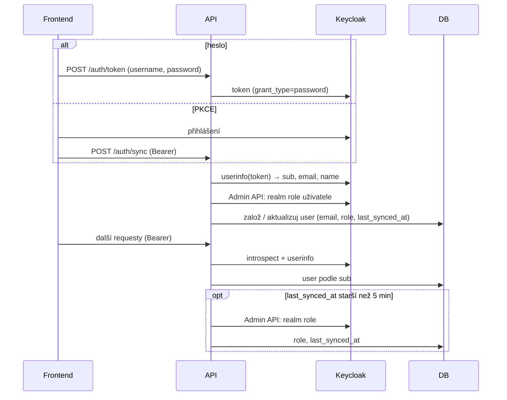

# Přihlášení (`auth`)

Identitu uživatele drží Keycloak, aplikace má vlastní kopii v tabulce `user`. Tato složka řeší přihlášení, synchronizaci uživatele a role z Keycloaku do DB a profil přihlášeného uživatele (jméno, AI styl).

Logika ověření tokenu a role je v `api/dependencies.py`. Router tady je tenký.

## Pojmy

| Pojem | Význam |
| --- | --- |
| `sub` | ID uživatele v Keycloaku. Podle něj se páruje řádek v `user` (unikátní). |
| Realm role | Role v Keycloaku: `user`, `lector`, `guarantor`, `superadmin`. Jiné role se ignorují. |
| `User.role` | Jediná role v DB. Nejvyšší z realm rolí (`_resolve_highest_role`), bez role = `user`. |
| `last_synced_at` | Kdy se role naposledy načetla z Keycloaku. |
| Admin API | Keycloak Admin REST API. Odtud se čtou role (`_fetch_roles_from_admin_api`), ne z JWT. |
| `CurrentUser` | FastAPI dependency `auth.get_current_user`. Vrací `User` z DB. |
| `OptionalUser` | Jako `CurrentUser`, ale bez tokenu nebo s neplatným tokenem vrátí `None`. Pro veřejné endpointy. |
| `require_role(min)` | Pustí roli `min` a vyšší. Pořadí `user` < `lector` < `guarantor` < `superadmin`. |
| `ai_budget` | Dependency na routerech `agents` a `assessments`. Počítá AI tokeny a hlídá denní limit. |

## Tok

- Při loginu (`sync_user_from_token`) se role přepíše vždy. Přepíše se i `email`. `display_name` jen když je prázdné.
- Při běžném requestu (`get_current_user`) se role obnoví nejdřív po 5 minutách (`_ROLE_SYNC_TTL`). Email se tu neaktualizuje.
- Když uživatel v DB není, založí se při prvním requestu i bez `/auth/sync`.
- Když `sub` koliduje (nový `sub`, ale e-mail už v DB), `_create_user` převezme existující řádek podle e-mailu a přepíše mu `sub`. Bez shody vrátí 409.

## AI limit (`ai_budget`)

- Vždy nastaví `usage_context` (user + endpoint), aby se tokeny zapsaly do `ai_usage`.
- Limit je `settings.ai_daily_token_limit` (env `AI_DAILY_TOKEN_LIMIT`). `0` = vypnuto.
- Platí jen pro roli `user` a jen pro jiné metody než GET.
- Součet `input_tokens + output_tokens` za posledních 24 h. Při dosažení limitu 429.

## Oprávnění

| Akce | Kdo |
| --- | --- |
| Získat token, sync | kdokoliv s platnými údaji / tokenem |
| `me`, profil (jméno, AI styl) | přihlášený, jen sám sebe |

## Pravidla

- Role se nikdy nečte z JWT. Token slouží jen k identitě (`sub`).
- Neaktivní uživatel (`is_active = False`) dostane 403 při každém requestu.
- `display_name` profilu: 1–255 znaků.
- AI styl profilu: vstup i výstup je `{kód osy: kód nastavení}`. Validace a uložení v [`users/controllers.py`](../users/README.md).

## Soubory

| Soubor | Co dělá |
| --- | --- |
| `routers.py` | Token, sync, `me`, profil (jméno, AI styl). |
| `schemas.py` | `UserResponse`, `ProfileNameUpdate`. |
| `../../dependencies.py` | `Auth` (Keycloak klient, `get_current_user`, `sync_user_from_token`), mapa rolí, `require_role`, `OptionalUser`, `is_staff`, `ai_budget`. |
| `../../authorization.py` | Kontroly vlastnictví zdroje (`validate_owner_or_superadmin` apod.). |
| `../../config.py` | `KeycloakSettings`, `ai_daily_token_limit`. |

## Pozor na

- Když Admin API selže, `_fetch_roles_from_admin_api` vrátí `user` a ten se uloží. Výpadek Keycloak admin klienta tak tiše degraduje superadmina na `user` (při loginu hned, jinak po 5 min).
- Klient `app` musí mít zapnuté Service Accounts a role `realm-management`, jinak se role nenačtou (viz výše).
- Změna role v Keycloaku se projeví až po loginu nebo do 5 minut.
- `POST /auth/token` vrátí token i když sync selže (výsledek `sync_user_from_token` se ignoruje).
- Převzetí účtu podle e-mailu nekontroluje `email_verified` (komentář `ponytail:` v `_create_user`).
- Nedostupný Keycloak vrací 500, ne 503. Když se `KeycloakOpenID` nepovede inicializovat, `keycloak_openid` je `None` a každý request spadne na 500.
- `sync_user_from_token` nekontroluje `is_active`. Login projde, 403 přijde až na dalším requestu.
- Přepis `email` při loginu může narazit na `uq_user_email` (jiný řádek se stejným e-mailem). Globální handler vrátí 400.
- `ai_budget` kontroluje limit před requestem. Jeden velký request limit přetáhne.
