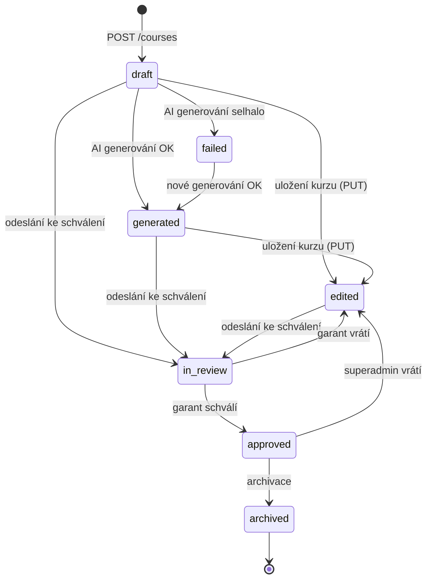

# Kurzy (`courses`)

Kurz je kořenová entita obsahu. Vlastní ho lektor, který ho vytvořil, schvaluje ho garant a teprve schválený kurz jde publikovat studentům.

Obsah kurzu (moduly, learn bloky, testy) má vlastní složky. Tato složka řeší kurz samotný, jeho stav, podklady (soubory, odkazy) a náhledový obrázek.

## Pojmy

| Pojem | Význam |
| --- | --- |
| `owner_id` | Lektor, který kurz vytvořil. Mění se jen v DB, API ho nepřepisuje. |
| `approved_by_id` | Kdo kurz schválil. Plní se při přechodu do `approved`, maže se při vrácení z `approved` do `edited`. |
| `status` | Fáze tvorby a schvalování (enum `Status`), viz [Tok](#tok). |
| `is_published` | Viditelnost pro studenty. Samostatný příznak, nezávislý na `status`. |
| `is_active` | Soft delete. `False` = kurz je smazaný. |
| Editovatelný stav | `draft`, `generated`, `edited` (`assert_course_editable` v `common/utils.py`). Jen v nich jde měnit kurz, moduly, learn bloky, testy a obrázek. |
| Podklady | `CourseFile` (soubory v SeaweedFS, `courses/{id}/…`) a `CourseLink` (URL). Vstup pro AI generování. |
| Náhledový obrázek | `image_path`, vždy 1280×720 WebP v `course-images/{id}/cover-<hash>.webp`. `None` = výchozí obrázek na frontendu. |
| `modules_count_ai_generated` | Kolik modulů má AI vygenerovat (1–20, default 3). |

Hierarchie obsahu: `Course` → `Module` (unikátní `title` v rámci kurzu) → `LearnBlock` (max. jeden aktivní na modul). Testy (`CourseAssessment`) visí na modulu (`pretest`, `practice`, `assessment`) nebo přímo na kurzu (`course_final`).

## Tok

- Přechody na `in_review`, `approved`, `edited`, `archived` jdou přes `PUT /courses/{id}/status`. Mapa povolených přechodů je v `update_course_status`.
- `failed` nemá v mapě žádný přechod a není editovatelný. Opustí se jen novým AI generováním. Smazat ho smí jen superadmin.
- AI generování jde jen z `draft`/`failed`. Po prvním uložení (`edited`) už ne.
- Garant „vrací“ kurz přechodem `in_review` → `edited`. Stav `rejected` neexistuje.
- `archived` je konečný. Archivace nemění `is_published`: archivovaný kurz může zůstat v katalogu (záměr, odpublikovat jde ručně). Mezi doporučenými není.
- `generated` a `failed` nastavuje jen AI generování (`agents/routers.py`, `agents/course_generator/nodes/save_to_db.py`).
- `draft`/`generated` → `edited` se děje automaticky při každém `PUT /courses/{id}`.
- `is_published` jde přepnout jen ve stavu `approved` nebo `archived`.

## Oprávnění

Všechny zápisy vyžadují roli aspoň `lector` (`require_role`). Pak platí:

| Akce | Vlastník (lektor) | Garant (cizí kurz) | Superadmin |
| --- | --- | --- | --- |
| Vytvořit kurz | ano (stane se vlastníkem) | ano | ano |
| Upravit kurz, obrázek | ano, v editovatelném stavu | ne | ano, v editovatelném stavu |
| Soubory a odkazy přidat / smazat | ano, jen v `draft` | ne | ano, jen v `draft` |
| Spustit AI generování | ano, jen `draft` nebo `failed` | ne | ano |
| Odeslat ke schválení (`in_review`) | ano | ne | ano |
| Schválit / vrátit z `in_review` | ne (vlastní kurz nikdy) | ano | ano, ale ne vlastní kurz |
| Vrátit `approved` → `edited` | ne | ne | ano |
| Archivovat (`approved` → `archived`) | ano | ne | ano |
| Publikovat / odpublikovat | ano | ne | ano |
| Smazat | viz [Pravidla](#pravidla) | ne | vždy |

Čtení:

| Kdo | Co vidí |
| --- | --- |
| Nepřihlášený, `user` | Katalog jen `is_active` a `is_published` (parametry `is_published`/`include_inactive` se přepíšou). Detail nepublikovaného kurzu jen když je do něj zapsaný, jinak 404. |
| `lector` a výš | Všechny kurzy včetně konceptů a cizích, i read-only detail. |

## Pravidla

- Název kurzu je unikátní mezi aktivními kurzy (index `uq_course_title_active`).
- Do `in_review` jde jen kurz s aspoň jedním aktivním modulem (400). Obsah modulů se nekontroluje.
- Schvalovatel nesmí být vlastník. Hlídá to controller (400) i DB (`ck_course_owner_not_approver`).
- Při schválení se na pozadí spustí generování embeddingů (`_generate_embeddings` v `routers.py`). Chyba se jen zaloguje.
- Vrácení `approved` → `edited` zároveň nastaví `is_published = False` a smaže `approved_by_id`.
- Doporučené kurzy (`/courses/recommended`) jsou jen `is_active`, `is_published` a `status = approved`, bez kurzů, kam už je uživatel zapsaný. Boost +1000 za stejný obor jako zapsané kurzy, pak počet zápisů. `limit` je oříznutý na 1–24.
- Detail kurzu (`GET /courses/{id}`, `get_course`) je jen na `public_router` s volitelným přihlášením. `/recommended` musí být v routeru nad `/{course_id}`, jinak by ho chytil detail.
- Katalog se řadí podle počtu aktivních zápisů sestupně, pak podle `course_id`.
- Mazání:
  - `draft`: **hard delete** (smaže soubory ze SeaweedFS, `CourseFile`, `CourseLink`, kurz).
  - ostatní stavy: soft delete s kaskádou na moduly → learn bloky, soubory, odkazy a vazby na číselníky.
  - Vlastník smí mazat v `draft`, `generated`, `edited`, `in_review` a v `approved`, pokud není publikovaný. Jinak jen superadmin.
- Obrázek se servíruje veřejně (`GET /courses/{id}/image/{filename}`) bez kontroly publikace, `` neposílá auth. Název souboru obsahuje hash, takže se nedá uhodnout.
- Obrázek (upload i AI): JPG/PNG/WebP, max. 10 MB, ořez na střed do 16:9, průhlednost na bílé pozadí. Každá verze má nový název souboru, starý se smaže.
- Podkladový soubor: přípona z `SUPPORTED_EXTENSIONS`, max. `MAX_FILE_SIZE` (25 MB). Odkaz musí začínat `http://` nebo `https://` a být v kurzu unikátní.
- Feedback garanta (`feedbacks/`) jde přidat jen ke kurzu ve stavu `in_review` nebo `edited`.

## Soubory

| Soubor | Co dělá |
| --- | --- |
| `routers.py` | `public_router` (katalog, detail, doporučené, obrázek) a auth `router` (zápisy, soubory, odkazy). Spouští embeddingy po schválení. Stažení souboru je přímo tady. |
| `schemas.py` | Pydantic modely. `Course` dopočítává `modules_count`, `owner_display_name`, `image_url`. `CourseDetail` přidává moduly. |
| `controllers/create.py` | Vytvoření kurzu (validace číselníků, sync vazeb), upload souboru, přidání odkazu. |
| `controllers/read.py` | Katalog s filtry a počtem zápisů, detail, seznam souborů a odkazů. |
| `controllers/update.py` | Úprava kurzu, přechody stavů, publikování. |
| `controllers/delete.py` | Mazání kurzu, souboru, odkazu. |
| `controllers/image.py` | Normalizace a uložení obrázku. `normalize_course_image` a `store_course_image` používá i AI generátor obrázků. |
| `controllers/recommended.py` | Doporučené kurzy. |
| `../../authorization.py` | `validate_owner_or_superadmin`, `validate_guarantor_or_superadmin`, `validate_superadmin`. `validate_ownership` pouští i garanta, kurzy ho nepoužívají (jen `assessments` pro čtení při schvalování). |
| `../common/utils.py` | `assert_course_editable`, `course_visible_to`, `ensure_course_visible`. |
| `../agents/routers.py` | Spuštění a průběh AI generování kurzu, AI obrázek. |
