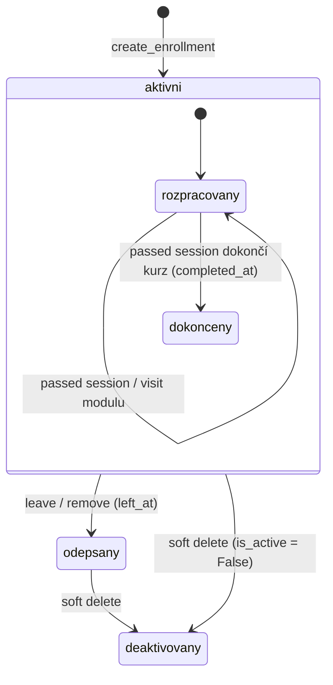

# Zápisy (`enrollments`)

Zápis uživatele do kurzu a jeho průběh. Postup v kurzu se neukládá. Počítá se živě z assessment sessions přes `course_completion`.

## Pojmy

| Pojem | Význam |
| --- | --- |
| zápis | Řádek `Enrollment` (`user_id`, `course_id`). |
| aktivní zápis | `is_active = True` a `left_at IS NULL`. Jen ten pouští k testům (`check_enrollment`). |
| `left_at` | Čas odepsání. Nastaví ho student sám (leave) nebo vlastník kurzu (remove). |
| `is_active = False` | Soft delete zápisu. Jen superadmin. |
| `completed_at` | Kdy student dokončil kurz. Nastaví ho assessments, ne tento modul. |
| hotový modul | Modul, kde má student `passed` session na všech povinných (`is_required`) zapnutých konfiguracích. |
| hotový kurz | Všechny aktivní moduly hotové + hotový povinný `course_final`, pokud existuje. |
| `last_visited_module_id` / `last_activity_at` | Kde student naposledy byl. Pro „Pokračuj, kde jsi skončil“. |
| `next_module` | První nehotový modul (řazeno podle `module_id`). `None` = vše hotovo. |

## Tok

Z `odepsany` ani `deaktivovany` se nejde vrátit. Nový zápis do stejného kurzu skončí 409.

Vazba na assessments:

1. `start_session` a `submit_answer` volají `check_enrollment`. Bez aktivního zápisu = 403.
2. Gate `PREREQUISITES`: `pretest` → `practice` → `assessment` → `course_final`. Počítají se jen povinné zapnuté konfigurace.
3. Při `passed` session volá `submit_answer` funkci `mark_course_completed`. Ta přepočítá `course_completion` a při hotovém kurzu zapíše `completed_at`.
4. `completed_at` = čas splnění posledního povinného testu, ne čas výpočtu.

## Oprávnění

| Akce | user | lector | guarantor | superadmin |
| --- | --- | --- | --- | --- |
| Zapsat sebe | ano | ano | ano | ano |
| Zapsat jiného uživatele | ne | ne | ano | ano |
| Odepsat se (leave) | vlastní zápis | vlastní zápis | vlastní zápis | vlastní zápis |
| Moje zápisy, visit, aktivita | ano | ano | ano | ano |
| Seznam všech zápisů | ne | ano, všechny kurzy | ano | ano |
| Seznam včetně neaktivních | ne | ne | ne | ano |
| Vyřadit studenta (remove, `left_at`) | ne | jen z vlastního kurzu | jen z vlastního kurzu | ano |
| Soft delete zápisu | ne | ne | ne | ano |

## Pravidla

- Zapsat se jde jen do kurzu, který je aktivní, publikovaný a `approved`. Jinak 400 nebo 404.
- Jeden uživatel má na kurz jeden zápis. Existující zápis (i odepsaný nebo deaktivovaný) = 409.
- DB hlídá unikátnost jen mezi aktivními zápisy (`uq_enrollment_user_course_active`).
- Leave i remove nastaví `left_at`. Opakované odepsání = 400.
- Soft delete už deaktivovaného zápisu = 400.
- `completed_at` se nastaví jen jednou. Pozdější průchody ho nemění.
- `mark_module_visited` je tichý no-op, když modul neexistuje nebo uživatel nemá aktivní zápis. Slouží k trackingu, ne k autorizaci.
- `my_enrollments` vrací jen aktivní zápisy v aktivních kurzech. Řadí podle `last_activity_at`, fallback `created_at` zápisu.
- `last_activity_at` bez visitu spadne na poslední `updated_at` assessment session v kurzu.
- Aktivita (heat mapa) sčítá za den: `passed` sessions, zápisy a dokončené kurzy. Max 400 dní, default 180. U každého dne max 3 popisky.

## Soubory

| Soubor | Obsah |
| --- | --- |
| `controllers.py` | Zápis, odepsání, soft delete, `my_enrollments`, visit, aktivita. |
| `schemas.py` | `Enrollment`, `MyEnrollment`, `ActivityResponse` a pomocná schémata. |
| `routers.py` | Endpointy pod `/enrollments`. |
| `../../models.py` | `Enrollment`. |
| `../common/utils.py` | `check_enrollment`, `get_or_404`. |
| `../assessments/utils.py` | `course_completion`, `assert_prerequisites_passed`. |
| `../assessments/controllers.py` | `PREREQUISITES`, `mark_course_completed`. |

## Pozor na

- Po odepsání se student do kurzu znovu nezapíše. Controller hledá jakýkoli zápis, nejen aktivní, i když DB index nový řádek dovolí.
- Garant nesmí vyřadit studenta z cizího kurzu (`validate_owner_or_superadmin`). Docstring routeru tvrdí opak.
- Seznam zápisů vidí každý lektor pro všechny kurzy. Vlastnictví kurzu se nekontroluje.
- Modul bez povinných testů je hotový hned. Kurz bez povinných testů je podle `course_completion` hotový, ale `completed_at` se nenastaví, protože se volá jen při `passed` session.
- `completed_at` se nemaže. Když lektor později přidá povinný test nebo modul, kurz má `completed_at` a zároveň `next_module`.
- Leave nekontroluje `is_active`. Odepsat jde i soft-smazaný zápis.
- Aktivita počítá zápisy a dokončení bez ohledu na `is_active` a `left_at`.
- Aktivita: když chybí `from_date` nebo `to_date`, ignorují se obě a platí `days`. Prohozený rozsah se otočí.
- `my_enrollments` volá `course_completion` pro každý kurz (N+1, označeno `ponytail:`).
