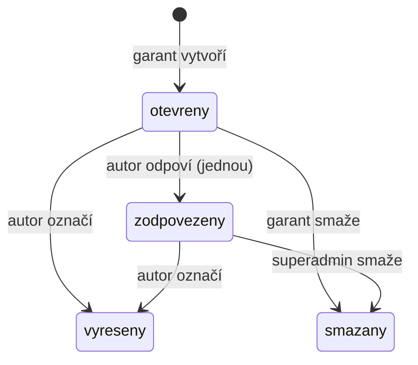

# Feedback garanta (`feedbacks`)

Garant při schvalování píše ke kurzu připomínky. Autor kurzu na každou jednou odpoví a označí ji jako vyřešenou.

Feedback visí na modulu, kurz se dohledá přes `module.course_id`. Stavy kurzu viz [`courses`](../courses/README.md).

## Pojmy

| Pojem | Význam |
| --- | --- |
| `CourseFeedback` | Jedna připomínka garanta. |
| `author_id` | Kdo připomínku napsal (garant nebo superadmin). |
| `module_id` | Modul, ke kterému se připomínka váže. Povinný. |
| `content_type` | Volitelné upřesnění místa, max. 20 znaků. V modelu komentář `"learn_block" \| "practice"`, API hodnotu nevaliduje. |
| `content_ref` | Volitelný identifikátor bloku nebo otázky, max. 100 znaků. |
| `feedback` | Text připomínky. Nesmí být prázdný. |
| `reply` | Odpověď autora kurzu. `None`, dokud neodpoví. |
| `is_resolved` | Autor označil za vyřešené. Default `False`. |
| Feedback sekce | Odpověď `GET /feedbacks`: základní údaje kurzu + seznam připomínek. |

## Tok

- Stavy v diagramu nejsou enum. Odvozují se z `reply` a `is_resolved`.
- `is_resolved` jde přepínat oběma směry a nezávisí na `reply`.

## Oprávnění

| Akce | `user` | `lector` | `guarantor` | `superadmin` |
| --- | --- | --- | --- | --- |
| Číst feedback sekci kurzu | ne | ano, libovolný kurz | ano | ano |
| Vytvořit | ne | ne | ano | ano |
| Odpovědět | ne | jen vlastník kurzu | jen vlastník kurzu | jen vlastník kurzu |
| Označit vyřešené / nevyřešené | ne | jen vlastník kurzu | jen vlastník kurzu | jen vlastník kurzu |
| Smazat | ne | ne | vlastní, jen bez odpovědi | vždy |

## Pravidla

- Vytvořit jde jen ke kurzu ve stavu `in_review` nebo `edited`, jinak 422.
- Modul i kurz musí být aktivní, jinak 404.
- Prázdný (jen mezery) text připomínky nebo odpovědi vrátí 422.
- Odpověď jde přidat jen jednou (409). Upravit ji nejde.
- Odpověď a označení se nevážou na stav kurzu.
- Smazání je soft delete.
- Seznam je řazený podle `created_at` vzestupně. `reply_filter`: `all`, `with_reply`, `without_reply`.

## Soubory

| Soubor | Co dělá |
| --- | --- |
| `routers.py` | Endpointy a role (`require_role`). |
| `controllers.py` | Čtení sekce, vytvoření, odpověď, vyřešení, smazání. Kontrola vlastníka a stavu kurzu. |
| `schemas.py` | `FeedbackSection`, `FeedbackItem` (s autorem a modulem), vstupní modely. |
| `../../models.py` | `CourseFeedback`. |

## Pozor na

- Docstring `POST /feedbacks` říká jen `in_review`. Controller pustí i `edited`.
- Superadmin, který není vlastník kurzu, nemůže odpovědět ani označit vyřešené.
- Garant může psát feedback i k vlastnímu kurzu. Kontrola „autor ≠ vlastník“ chybí.
- Čtení nekontroluje vztah ke kurzu. Každý lektor vidí feedback ke všem kurzům.
- Seznam nefiltruje `Module.is_active`. Feedback ke smazanému modulu se pořád zobrazuje.
- `content_type` a `content_ref` nemají limit délky ve schématu. Delší hodnota spadne až v DB (500).
- Větev `else` v `delete_feedback` je nedosažitelná, router pouští jen `guarantor` a výš.
- Feedback není ticket. Obecné stížnosti ke kurzu řeší [`tickets`](../tickets/README.md) (`TicketType.course_feedback`).
