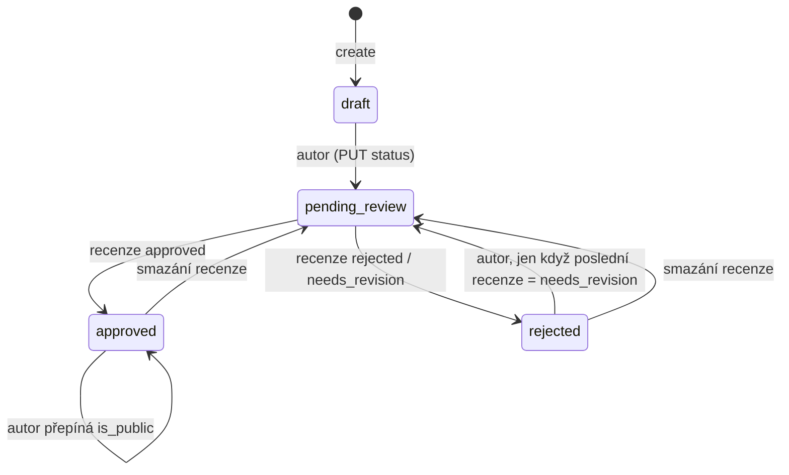

# Veřejná databáze materiálů (`publicDB`)

Sdílená knihovna výukových materiálů. Uživatel nahraje materiál se soubory, garant ho schválí a autor ho pak může zveřejnit, ostatní ho hodnotí, forkují a ukládají do sbírek.

Na frontendu ji používá stránka `/verejna-databaze` (záložky Veřejná databáze, Sbírky, Moje sbírka) a přehled materiálů ke schválení.

## Pojmy

| Pojem | Model / tabulka | Význam |
| --- | --- | --- |
| Materiál | `PubResource` / `pub_resource` | Výukový materiál s metadaty z katalogů (EQF, typ kurzu, obor, KRAUU, Bloom…). Vlastník = `author_id`. |
| Soubor | `PubResourceFile` | Příloha materiálu. Obsah je v SeaweedFS na `resources/{resource_id}/{filename}`. |
| Status | `PubResourceStatus` | `draft`, `pending_review`, `approved`, `rejected`. |
| Veřejný | `is_public` | Materiál je vidět ve veřejné databázi. Nezávislé na statusu, ale jde nastavit jen u `approved`. |
| Recenze | `PubResourceReview` | Verdikt garanta (`approved`, `rejected`, `needs_revision`). Mění status materiálu. |
| Komentář | `PubResourceComment` | Zpětná vazba garanta bez verdiktu. Status nemění. |
| Hodnocení | `PubResourceRating` | 1–5 hvězd + volitelný text. Jedno na uživatele a materiál. |
| Fork | `PubResourceFork` | Kopie cizího materiálu. Nový `PubResource` s `is_fork=True` + vazba `original_id → forked_id`. |
| Sbírka | `PubCollection` + `PubCollectionResource` | Uživatelova složka materiálů (na frontendu „složka“). Může být veřejná. |

## Tok

`rejected` s verdiktem `rejected` je konečný stav. Ven vede jen smazání recenze garantem. Z `approved` se autor do `draft` nevrátí.

## Oprávnění

Role mají hierarchii `user < lector < guarantor < superadmin` (`require_role` pustí roli a vyšší).

| Akce | Kdo |
| --- | --- |
| Seznam materiálů, veřejné sbírky | Kdokoli, i bez přihlášení |
| Detail materiálu, soubory, komentáře, hodnocení, recenze | Přihlášený uživatel |
| Vytvořit materiál, fork, hodnocení, sbírku | Přihlášený uživatel |
| Upravit / smazat materiál, nahrát / smazat soubor, poslat k recenzi, zveřejnit | Autor nebo superadmin |
| Upravit / smazat hodnocení | Autor hodnocení nebo superadmin |
| Upravit / smazat sbírku a její položky | Vlastník sbírky nebo superadmin |
| Detail neveřejné sbírky | Vlastník nebo superadmin |
| Recenze, komentář (vytvořit, smazat) | Garant nebo superadmin |
| Smazat komentář | Jeho autor nebo superadmin |

Garant nemá přístup k cizím materiálům mimo recenze a komentáře (`validate_owner_or_superadmin`).

## Pravidla

- Nový materiál je vždy `draft`, `is_public=False`.
- Název materiálu je unikátní mezi aktivními materiály jednoho autora. Totéž pro název sbírky (kontroluje se jen při vytvoření).
- `krauu_competence_ids` a `bloom_level_ids` musí mít aspoň 1 položku.
- Upravit lze jen `draft`, nebo `rejected` s poslední recenzí `needs_revision`.
- Recenze a komentář jdou jen na materiál v `pending_review`.
- Zveřejnit / skrýt jde jen `approved` materiál. Nastavení stejné hodnoty vrátí 400.
- Fork: originál musí být veřejný, mít `allow_forks=True` a nesmí být sám fork. Fork kopíruje metadata a KRAUU/Bloom, ne soubory. Fork má `allow_forks=False`.
- Smazání materiálu: nejde, když je veřejný, nebo `approved` s `allow_forks`. `draft` se maže natvrdo včetně souborů v úložišti, ostatní soft delete s kaskádou (soubory, hodnocení, recenze, komentáře, KRAUU, Bloom).
- Smazat soubor jde jen ve stavu `draft` nebo `rejected`. Velikost souboru max 30 MB. Typ se určuje z obsahu (`filetype`).
- Hodnocení: skóre 1–5 (kontrola v kódu i DB constraint), jedno aktivní na uživatele a materiál.
- Do sbírky jde přidat jen `approved` materiál. Neveřejný jen jeho autor.
- Položky sbírky se filtrují: ostatní vidí jen aktivní, veřejné a `approved`. Vlastník sbírky navíc vidí své vlastní neveřejné materiály.
- Smazání sbírky je soft delete s kaskádou na položky. Odebrání položky je hard delete.
- `ratings_count`, `avg_rating`, `files_count`, `forks_count` a `forked_from_id` se dopočítávají v dotazu, nejsou v tabulce.

## Soubory

| Soubor | Co dělá |
| --- | --- |
| `resources/routers.py` | Materiály, soubory, komentáře, fork. `public_router` = jen seznam bez přihlášení. Stažení souboru je přímo tady. |
| `resources/controllers/create.py` | Vytvoření materiálu, upload souboru, fork. |
| `resources/controllers/read.py` | Seznam s filtry a detail s dopočtenými počty. |
| `resources/controllers/update.py` | Úprava, přechod statusu, zveřejnění. |
| `resources/controllers/delete.py` | Smazání materiálu (hard/soft) a souboru. |
| `resources/controllers/comment.py` | Komentáře garanta. |
| `reviews/` | Recenze, mění status materiálu. |
| `rating/` | Hodnocení 1–5. |
| `collections/` | Sbírky. `public_router` = veřejné sbírky bez přihlášení. Pravidla viditelnosti položek v `controllers/read.py`. |
| `*/schemas.py` | Pydantic schémata. `*_display_name` se plní z ORM vztahů v `model_validator`. |

Modely jsou v `api/models.py` (`PubResource*`, `PubCollection*`), routery se registrují v `api/src/routers.py`.

## Pozor na

- `GET /resources` je bez přihlášení a defaultně vrací **všechny** materiály (i `draft`, cizí, s `include_inactive` i smazané). Filtr `is_published` je opt-in. Frontend na tom staví „Moje sbírka“ (stáhne vše a filtruje podle autora).
- Detail materiálu, seznam souborů a stažení souboru nekontrolují status, `is_public` ani `is_active`. Seznam souborů a stažení vrací i soft-smazané soubory.
- Hodnotit jde jakýkoli aktivní materiál, i `draft` nebo vlastní.
- Upload souboru nekontroluje status. Stejný název souboru přepíše objekt v úložišti a dva záznamy pak ukazují na jeden soubor.
- Smazání recenze vrátí materiál do `pending_review` bez ohledu na to, jestli byla poslední. `is_public` zůstane. Garant smaže i cizí recenzi.
- `update_resource` vyžaduje existující `subject_id` a `target_id`, i když jsou ve schématu volitelné. `None` vrátí 400.
- Omezení u forku v `update_resource` se spustí jen když se mění obor, cílovka, úroveň i obtížnost **najednou** (`and`).
- `update_resource_status` porovnává `new_status in <enum hodnota>`. Funguje díky `Literal` v routeru, ne díky logice.
- Hard delete `draft` materiálu nemaže vazby KRAUU/Bloom ani záznam forku. Ověřit, že neselže na FK.
- `DELETE /resources/{id}/comments/{comment_id}` ignoruje `resource_id` a vrací 200 místo 204.
- `POST /ratings/{id}` bere `resource_id`, `PUT/DELETE /ratings/{id}` bere `rating_id`.
- Úprava sbírky ignoruje `None`, popis tedy nejde vymazat.
- Testy modul nemá.
