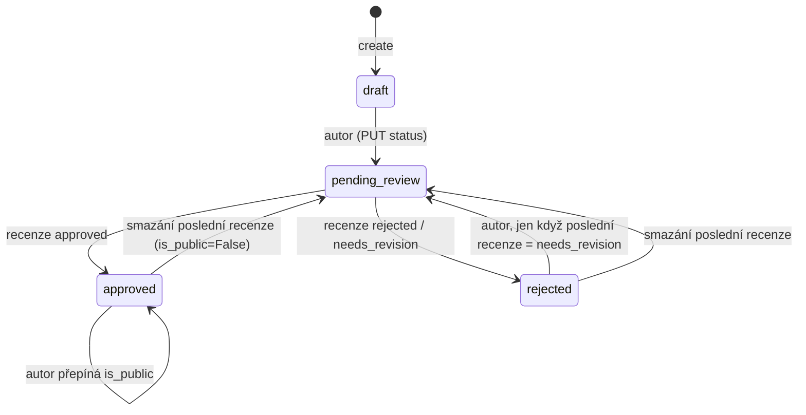

# Veřejná databáze materiálů (`publicDB`)

Sdílená knihovna výukových materiálů. Uživatel nahraje materiál se soubory, garant ho schválí a autor ho pak může zveřejnit, ostatní ho hodnotí, forkují a ukládají do sbírek.

Na frontendu ji používá stránka `/verejna-databaze` (záložky Veřejná databáze, Sbírky, Moje sbírka) a přehled materiálů ke schválení.

## Pojmy

| Pojem | Model / tabulka | Význam |
| --- | --- | --- |
| Materiál | `PubResource` / `pub_resource` | Výukový materiál s metadaty z katalogů (EQF, typ kurzu, obor, KRAUU, Bloom…). Vlastník = `author_id`. |
| Soubor | `PubResourceFile` | Příloha materiálu. Obsah je v SeaweedFS na `resources/{resource_id}/{filename}`. |
| Status | `PubResourceStatus` | `draft`, `pending_review`, `approved`, `rejected`. |
| Veřejný | `is_public` | Materiál je vidět ve veřejné databázi. Nezávislé na statusu, ale jde nastavit jen u `approved`. |
| Recenze | `PubResourceReview` | Verdikt garanta (`approved`, `rejected`, `needs_revision`). Mění status materiálu. |
| Komentář | `PubResourceComment` | Zpětná vazba garanta bez verdiktu. Status nemění. |
| Hodnocení | `PubResourceRating` | 1–5 hvězd + volitelný text. Jedno na uživatele a materiál. |
| Fork | `PubResourceFork` | Kopie cizího materiálu. Nový `PubResource` s `is_fork=True` + vazba `original_id → forked_id`. |
| Sbírka | `PubCollection` + `PubCollectionResource` | Uživatelova složka materiálů (na frontendu „složka“). Může být veřejná. |

## Tok

`rejected` s verdiktem `rejected` je konečný stav. Ven vede jen smazání recenze garantem. Z `approved` se autor do `draft` nevrátí.

## Oprávnění

Role mají hierarchii `user < lector < guarantor < superadmin` (`require_role` pustí roli a vyšší).

| Akce | Kdo |
| --- | --- |
| Seznam materiálů, veřejné sbírky | Kdokoli, i bez přihlášení (materiály podle [viditelnosti](#viditelnost-materiálů)) |
| Detail materiálu, soubory, stažení souboru, komentáře | Přihlášený uživatel, který materiál smí vidět (jinak 404) |
| Hodnocení, recenze (čtení) | Přihlášený uživatel |
| Vytvořit materiál, fork, hodnocení, sbírku | Přihlášený uživatel |
| Upravit / smazat materiál, nahrát / smazat soubor, poslat k recenzi, zveřejnit | Autor nebo superadmin |
| Upravit / smazat hodnocení | Autor hodnocení nebo superadmin |
| Upravit / smazat sbírku a její položky | Vlastník sbírky nebo superadmin |
| Detail neveřejné sbírky | Vlastník nebo superadmin |
| Recenze, komentář (vytvořit) | Garant nebo superadmin |
| Smazat recenzi | Její autor (garant) nebo superadmin |
| Smazat komentář | Jeho autor nebo superadmin |

Garant cizí materiál neupraví ani nesmaže (`validate_owner_or_superadmin`). Číst smí navíc materiály v `pending_review`, které schvaluje.

### Viditelnost materiálů

Pravidla jsou na jednom místě v `resources/visibility.py`. Platí pro seznam, detail, seznam souborů, stažení souboru a komentáře.

| Kdo | Seznam `GET /resources` | Detail, soubory, stažení, komentáře |
| --- | --- | --- |
| Nepřihlášený, `user`, `lector` | Jen publikované (`is_public`) a aktivní | Totéž |
| `guarantor` | Totéž + `pending_review` (aktivní) | Totéž + `pending_review` (aktivní) |
| `superadmin` | Vše kromě cizích `draft`/`rejected`, i nepublikované a neaktivní (podle `is_published` a `include_inactive`) | Vše |
| Autor materiálu | Navíc všechny své aktivní materiály v jakémkoli stavu (i `draft`, `rejected`, nepublikované) | Svůj materiál vždy, i `draft`, `rejected` a smazaný |

- Cizí `draft` a `rejected` seznam nevrací nikomu, ani superadminovi, ani s filtrem `status`. Autor své vidí.
- Autor ve výpisu nevidí své smazané (neaktivní) materiály, ani s `include_inactive` (to platí jen pro superadmina).
- `is_published=true` zúží výpis na publikované, takže autorovy nepublikované materiály zmizí. Pro „moje materiály“ ho frontend posílat nemá.
- Materiál, který uživatel nesmí vidět, dostane stejnou 404 jako neexistující, aby nešlo zjistit, která ID existují.
- Parametry `is_published` a `include_inactive` mají vliv jen u superadmina, ostatním pravidla obejít nejdou.

## Pravidla

- Nový materiál je vždy `draft`, `is_public=False`.
- Název materiálu je unikátní mezi aktivními materiály jednoho autora. Totéž pro název sbírky (kontroluje se jen při vytvoření).
- `krauu_competence_ids` a `bloom_level_ids` musí mít aspoň 1 položku.
- Upravit lze jen `draft`, nebo `rejected` s poslední recenzí `needs_revision`.
- Smazat lze jen poslední aktivní recenzi materiálu (jinak 400), protože jen ta určuje jeho stav. Smazání je soft delete (`is_active=False`), vrátí materiál do `pending_review` a nastaví `is_public=False`.
- Recenze a komentář jdou jen na materiál v `pending_review`.
- Zveřejnit / skrýt jde jen `approved` materiál. Nastavení stejné hodnoty vrátí 400.
- Fork: originál musí být veřejný, mít `allow_forks=True` a nesmí být sám fork. Fork kopíruje metadata a KRAUU/Bloom, ne soubory. Fork má `allow_forks=False`. U forku nejde změnit obor, cílovou skupinu, vzdělávací úroveň ani obtížnost (`FORK_LOCKED_FIELDS` v `update.py`, 400). Kontrolují se jen pole, která klient poslal.
- Smazání materiálu: nejde, když je veřejný, nebo `approved` s `allow_forks`. `draft` se maže natvrdo spolu s KRAUU, Bloom, soubory a záznamem forku (soubory v úložišti až po commitu DB). Pokud má draft hodnocení, recenze, komentáře, položky sbírek nebo z něj vznikl fork, vrátí 400. Ostatní stavy soft delete s kaskádou (soubory, hodnocení, recenze, komentáře, KRAUU, Bloom).
- Smazat soubor jde jen ve stavu `draft` nebo `rejected`. Velikost souboru max 30 MB. Typ se určuje z obsahu (`filetype`).
- Hodnocení: jen u aktivního materiálu ve stavu `approved`, který uživatel smí vidět (jinak 404). Vlastní materiál hodnotit nejde (403). Skóre 1–5 (kontrola v kódu i DB constraint), jedno aktivní na uživatele a materiál.
- Do sbírky jde přidat jen `approved` materiál. Neveřejný jen jeho autor.
- Položky sbírky se filtrují: ostatní vidí jen aktivní, veřejné a `approved`. Vlastník sbírky navíc vidí své vlastní neveřejné materiály.
- Smazání sbírky je soft delete s kaskádou na položky. Odebrání položky je hard delete.
- `ratings_count`, `avg_rating`, `files_count`, `forks_count` a `forked_from_id` se dopočítávají v dotazu, nejsou v tabulce.

## Soubory

| Soubor | Co dělá |
| --- | --- |
| `resources/routers.py` | Materiály, soubory, komentáře, fork. `public_router` = jen seznam bez přihlášení (přihlášení je volitelné přes `OptionalUser`). Stažení souboru je přímo tady. |
| `resources/visibility.py` | Kdo smí vidět materiál: `resource_visible_to` (jeden materiál), `resource_visibility_clause` (SQL podmínka pro seznam), `ensure_resource_visible` (načte nebo 404). |
| `resources/controllers/create.py` | Vytvoření materiálu, upload souboru, fork. |
| `resources/controllers/read.py` | Seznam s filtry a detail s dopočtenými počty. |
| `resources/controllers/update.py` | Úprava, přechod statusu, zveřejnění. |
| `resources/controllers/delete.py` | Smazání materiálu (hard/soft) a souboru. |
| `resources/controllers/comment.py` | Komentáře garanta. |
| `reviews/` | Recenze, mění status materiálu. |
| `rating/` | Hodnocení 1–5. |
| `collections/` | Sbírky. `public_router` = veřejné sbírky bez přihlášení. Pravidla viditelnosti položek v `controllers/read.py`. |
| `*/schemas.py` | Pydantic schémata. `*_display_name` se plní z ORM vztahů v `model_validator`. |

Modely jsou v `api/models.py` (`PubResource*`, `PubCollection*`), routery se registrují v `api/src/routers.py`.

## Pozor na

- `GET /resources` nemá filtr podle autora. „Moje sbírka“ na frontendu stáhne vše viditelné a filtruje podle `author_id` na klientovi.
- Testy modul nemá.
