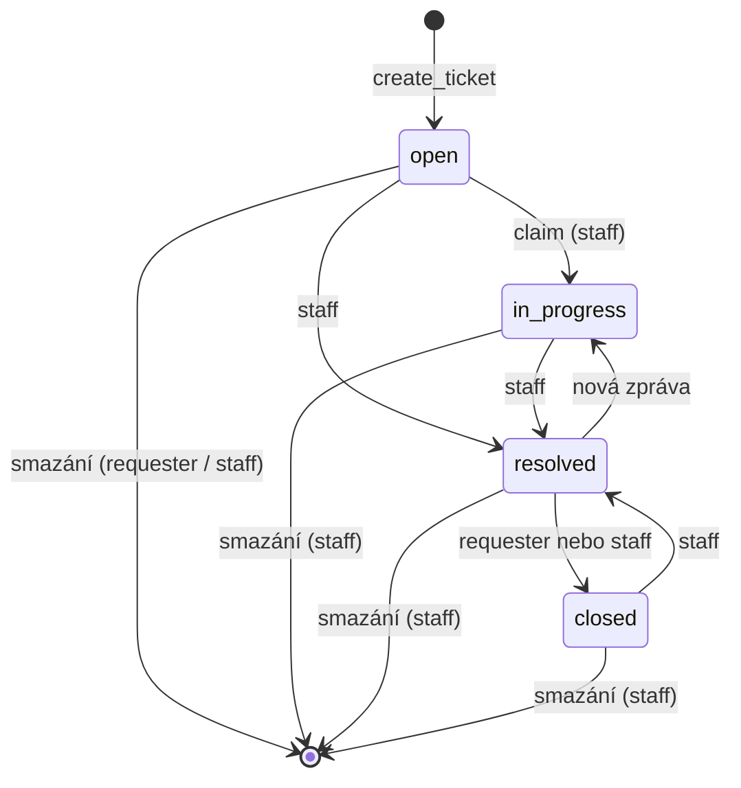

# Tickety (`tickets`)

Obecný systém reklamací a dotazů. Ticket se váže na modul, kurz, veřejný materiál, nebo na nic (`general`), a obsah žije ve vlákně zpráv.

## Pojmy

| Pojem | Význam |
| --- | --- |
| `requester` | Kdo ticket založil (`requester_id`). |
| `assignee` | Staff, který si ticket přiřadil přes claim (`assignee_id`). Jinak `null`. |
| `entity_type` / `entity_id` | Na co se ticket váže: `module`, `course`, `pub_resource`, `general`. U `general` je `entity_id` vždy `null`, u ostatních povinné. |
| `course_id` | Denormalizovaný kurz. Doplní ho resolver. U `pub_resource` a `general` je `null`. |
| `category` | Kategorie ticketu (`TicketType`). Povolené hodnoty závisí na `entity_type`. |
| resolver | Třída v `resolvers.py` s pravidly jednoho `entity_type`: načtení entity, kdo smí založit, kdo je staff, `course_id`. |
| staff | Kdo smí ticket řešit. Rozhoduje `resolver.is_staff_for`. |
| interní poznámka | Zpráva s `is_internal = True`. Vidí ji jen staff. |

Kategorie podle `entity_type` (k nim vždy navíc `bug`, `question`, `other`):

| `entity_type` | Vlastní kategorie | Staff |
| --- | --- | --- |
| `module` | `task_session`, `practice` | vlastník kurzu (lektor), garant, superadmin |
| `course` | `course_feedback` | vlastník kurzu (lektor), garant, superadmin |
| `pub_resource` | `content_issue` | garant, superadmin |
| `general` | – | garant, superadmin |

## Tok

`pending` je v enumu jen kvůli DB. Kód ho nikde nenastavuje.

## Oprávnění

„vlastní“ = actor je requester. „staff“ = viz tabulka kategorií.

| Akce | user | lector | guarantor | superadmin |
| --- | --- | --- | --- | --- |
| Číst kategorie (`/tickets/categories`) | ano, i bez přihlášení | ano | ano | ano |
| Založit k `module` | jen zapsaný v kurzu | jen zapsaný v kurzu | jen zapsaný v kurzu | jen zapsaný v kurzu |
| Založit ke `course` | jen zapsaný | zapsaný nebo vlastník kurzu | jen zapsaný | vždy |
| Založit k `pub_resource` / `general` | ano | ano | ano | ano |
| Seznam ticketů | vlastní | vlastní + tickety vlastních kurzů | všechny | všechny |
| Detail a zprávy | vlastní | vlastní + kde je staff | všechny | všechny |
| Vidět interní poznámky | ne | kde je staff | ano | ano |
| Přidat zprávu | vlastní | vlastní + kde je staff | ano | ano |
| Přidat interní poznámku | ne | kde je staff | ano | ano |
| Claim (`open` → `in_progress`) | ne | kde je staff | ano | ano |
| Nastavit `resolved` | ne | kde je staff | ano | ano |
| Nastavit `closed` (jen z `resolved`) | vlastní | vlastní + kde je staff | ano | ano |
| Smazat | vlastní, jen ve stavu `open` | vlastní ve stavu `open` + kde je staff vždy | vždy | vždy |

Všechny endpointy kromě kategorií mají `require_role("user")`. Skutečná práva řeší controller a resolver.

## Pravidla

- Requester smí mít k jedné entitě a kategorii jen jeden aktivní nevyřešený ticket (`open`, `in_progress`, `pending`). Jinak 409. Hlídá to controller i částečný unikátní index `uq_ticket_requester_entity_category`.
- Pro `general` se duplicita nehlídá (`entity_id` je `null`).
- Kategorie se validuje v `TicketCreate` proti `get_allowed_categories(entity_type)`. Špatná kombinace = 422.
- Založení ticketu vytvoří i první zprávu (`message`) od requestera.
- Claim jde jen ze stavu `open`. Nastaví `assignee_id` a `in_progress`.
- Ručně (`PUT`) jdou nastavit jen `resolved` a `closed`. Ostatní stavy = 400.
- `closed` jde jen z `resolved`, jinak 400.
- Zpráva na `resolved` ticket ho vrátí do `in_progress`. Předtím se znovu ověří duplicita.
- Na `closed` ticket nejde přidat zprávu (409).
- Requester nevidí interní poznámky. Staff vidí vše.
- Mazání je soft delete (`is_active = False`). Kaskádově smaže i zprávy.

## Soubory

| Soubor | Obsah |
| --- | --- |
| `controllers.py` | Veškerá logika: výpis, detail, založení, zprávy, claim, změna stavu, mazání, kontrola duplicit. |
| `resolvers.py` | Resolver pro každý `entity_type`, registr `RESOLVERS`, `UNIVERSAL_CATEGORIES`, `is_course_staff`. |
| `schemas.py` | Pydantic schémata. `TicketCreate` validuje `entity_id` a kategorii. |
| `routers.py` | `router` (přihlášení) a `public_router` (jen `/categories`). |
| `../../models.py` | `Ticket`, `TicketMessage`. |
| `../../enums.py` | `TicketStatus`, `TicketType`, `TicketEntityType`. |

Nový `entity_type` = nová hodnota v `TicketEntityType`, nový resolver a záznam v `RESOLVERS`.

## Pozor na

- **Jakákoli zpráva** na `resolved` ticketu ho znovu otevře. Platí i pro odpověď nebo interní poznámku staffu, nejen pro requestera.
- `resolved` jde nastavit z libovolného stavu, i z `closed`. Staff tak může uzavřený ticket znovu otevřít.
- `resolved` jde nastavit i bez claimu. `assignee_id` pak zůstane `null`.
- Po claimu může ticket dál řešit kterýkoli staff, nejen `assignee`.
- Requester nemůže zavřít ticket, který není `resolved`. Může ho jen smazat, a to jen v `open`.
- Staff smí smazat ticket v libovolném stavu. Docstring `delete_ticket` mluví jen o superadminovi, kód pouští každého staff.
- Garant nemá u `course` ticketu bypass zápisu. Bez zápisu ho nezaloží, i když je pro kurz staff.
- Práva k existujícímu ticketu se počítají přes entitu. Když je modul, kurz nebo materiál smazaný, `load_entity` vrátí 404 a ticket je nedostupný i pro requestera.
- Lektor v seznamu nevidí tickety `pub_resource` a `general` (nejsou staff). Vidí jen své vlastní.
