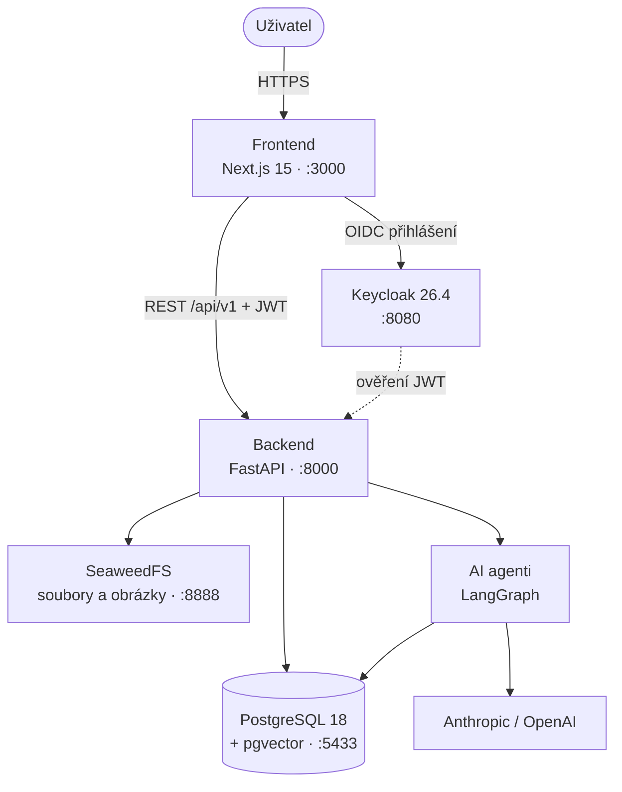

# Architektura

## Přehled



| Služba | Co dělá |
| --- | --- |
| **Frontend** | Veřejná část, studium a administrace. API volá přes klienta generovaného z OpenAPI |
| **Backend** | REST API. Ověřuje JWT z Keycloaku a role synchronizuje do DB při přihlášení. Spotřebu AI tokenů zapisuje do `ai_usage` |
| **AI agenti** | Grafy v LangGraph, běží uvnitř backendu. Vektory ukládají do pgvectoru. Viz [backend/agents/](../backend/agents/README.md) |
| **PostgreSQL** | Data aplikace, embeddingy (pgvector) a nastavení agentů (`system_setting`) |
| **Keycloak** | Uživatelé, přihlášení a role. Dev realm se importuje z `infra/keycloak/` |
| **SeaweedFS** | Nahrané soubory a obrázky |

Při startu API vytvoří chybějící tabulky (`init_db`) a naplní číselníky a nastavení (`seed_db`). Změny existujících tabulek dělají ruční SQL migrace, viz [CONTRIBUTING](../CONTRIBUTING.md#migrace-db).

## Učební model

Kurz se skládá z modulů. Modul obsahuje studijní obsah (LearnBlocky s AI mentorem) a testy. Každý modul prochází student v pořadí pretest → procvičování → závěrečný test, na konci kurzu je závěrečný test celého kurzu.

Podrobnosti, pravidla odemykání a typy testů: [backend/api/src/assessments/](../backend/api/src/assessments/README.md).

## Role

Role se spravují v Keycloaku jako realm roles. Do DB se synchronizují při přihlášení.

| Role | Co smí |
| --- | --- |
| `user` | Procházet katalog, zapsat se do kurzu, absolvovat ho |
| `lector` | Navíc tvořit a spravovat vlastní kurzy |
| `guarantor` | Navíc kontrolovat a schvalovat kurzy, psát k nim feedback |
| `superadmin` | Navíc spravovat systémová nastavení, uživatele a číselníky |

Kontroly vlastnictví jsou v [`backend/api/authorization.py`](../backend/api/authorization.py).

## Struktura projektu

```text
├── backend/
│   ├── api/
│   │   ├── main.py            # FastAPI app, middleware, lifespan
│   │   ├── models.py          # SQLAlchemy modely
│   │   ├── seed.py            # číselníky, prompty a modely agentů
│   │   ├── config.py          # nastavení z .env
│   │   ├── dependencies.py    # CurrentUser, Keycloak, AI limit
│   │   ├── authorization.py   # kontroly vlastníka a rolí
│   │   └── src/               # jedna složka = jeden router
│   │       ├── assessments/   # testy: formáty, gate, sessions
│   │       ├── courses/  modules/  activities/  enrollments/
│   │       ├── tickets/  feedbacks/  users/  superadmin/
│   │       ├── catalogs/  editor_images/  publicDB/  agents/  auth/
│   │       └── common/        # sdílené utility
│   ├── agents/                # LangGraph agenti
│   └── scripts/               # update_system_settings
├── frontend/src/
│   ├── app/(main)/            # veřejná část a studium
│   ├── app/admin/             # administrace
│   ├── api/                   # generovaný OpenAPI klient
│   └── components/
├── migrations/                # ruční SQL migrace, číslované
├── infra/
│   ├── docker/                # Dockerfily, init-db.sql
│   └── keycloak/              # dev realm a téma
├── compose.yml
└── Makefile
```
