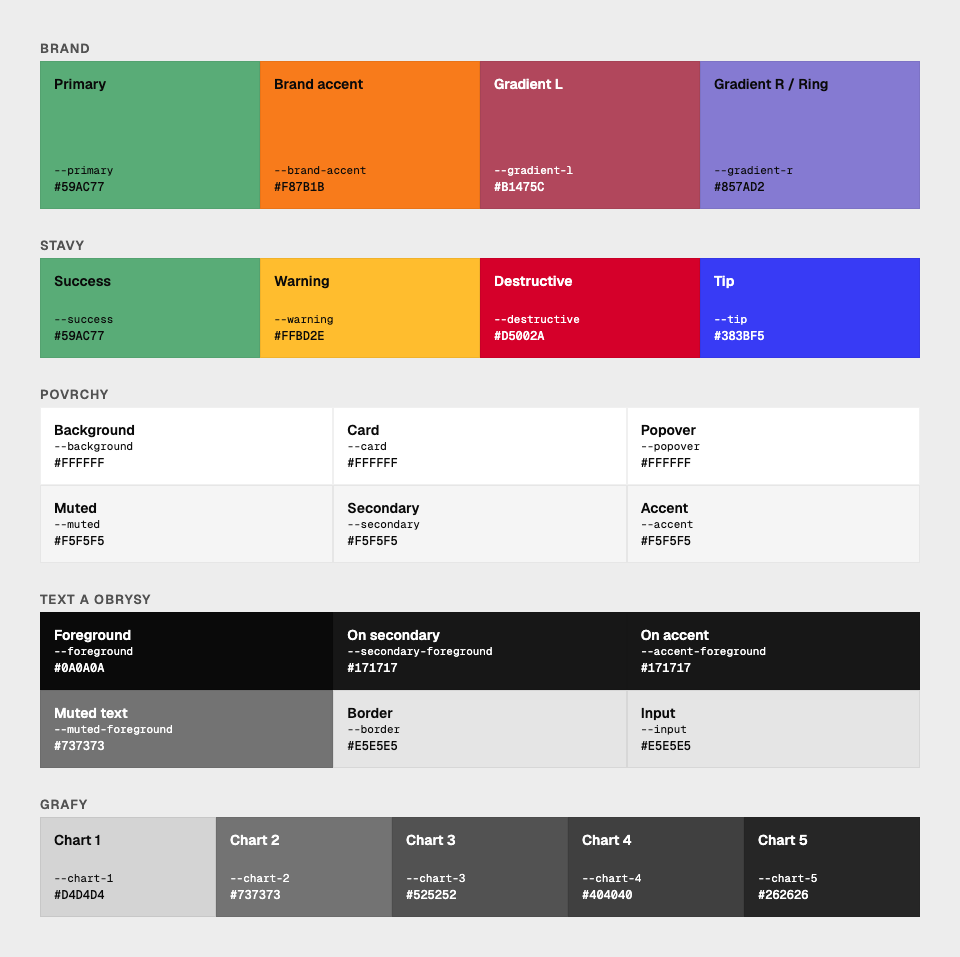
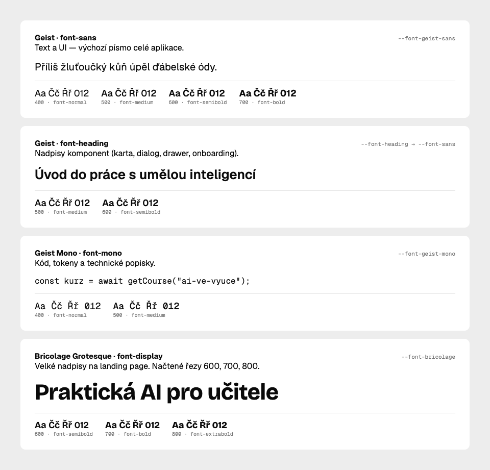

# UI konvence

Next.js 15 (App Router) + Tailwind v4 + shadcn/ui na Base UI.

## Kde co leží

| Cesta | Co to je |
| --- | --- |
| `src/components/ui-kit/` | shadcn primitiva. Sem píše `shadcn` CLI (viz `components.json` → alias `ui`). Needitovat ručně bez důvodu. |
| `src/components/ui/` | Projektové komponenty (`Modal`, `ConfirmModal`, `Dropdown`, `CourseCard`, `Badge`, `Skeletons`, `Toast`, `RichTextEditor`) + `index.ts` barrel. |
| `src/app/globals.css` | Design tokeny (Figma paleta → shadcn sémantické proměnné). Jediné místo pro CSS proměnné. |
| `/ui-kit` (`src/app/ui-kit/page.tsx`) | Živý showcase kitu — všechny varianty a velikosti. |

## Importy

Vždycky z barrelu, ne z konkrétních souborů:

```tsx
import { Button, Card, CardHeader, Dialog, Alert, Input, Tabs } from "@/components/ui";
```

Nové primitivum se přidává takhle:

```bash
npx shadcn@latest add tooltip     # spadne do src/components/ui-kit/
```

…a pak se **re-exportuje** v `src/components/ui/index.ts`, jinak není přes barrel vidět.

## Co kit obsahuje

`accordion`, `alert`, `badge`, `button`, `card`, `checkbox`, `dialog`, `drawer`, `dropdown-menu`,
`input`, `label`, `progress`, `radio-group`, `select`, `separator`, `skeleton`, `slider`, `status-select`, `switch`,
`table`, `tabs`, `textarea`, `toast`, `tooltip`.

`Slider` z kitu bere `value` jako pole (`value={[zoom]}`) — s holým číslem vykreslí dva táhla.
Pozor: shadcn CLI 4.22 generuje `import { cn } from "cn"` a přidá do `package.json` balíček `cn`;
import přepiš na `@/lib/utils` a `cn` z `package.json` vrať.

Chybí-li něco (popover, command, pagination…), přidej to CLI příkazem výše —
neimplementuj vlastní.

## Tlačítka

Žádné ručně stylované `<button className="px-4 py-2 bg-...">`. Vždycky `Button` z kitu:

```tsx
<Button variant="default" size="sm">Uložit</Button>
<Button variant="outline" size="icon-sm"><Pencil /></Button>
```

- `variant`: `default` | `outline` | `secondary` | `ghost` | `destructive` | `warning` | `brand` | `link`
  - `warning` — vratné, ale pozor-vyžadující akce (odpublikovat, vrátit k přepracování).
  - `brand` — značkové CTA v gradientu `gradient-l → gradient-r` (přihlášení, „Pokračovat" na kurzu).
- `size`: `default` | `xs` | `sm` | `lg` | `xl` | `icon` | `icon-xs` | `icon-sm` | `icon-lg`
- Ikona vedle textu se značí `data-icon`, bez sizing tříd — velikost řeší komponenta:

```tsx
<Button>
  <Search data-icon="inline-start" />
  Hledat
</Button>
```

- `Button` nemá `isLoading`. Loading se skládá: `disabled` + spinner jako ikona.
- Tlačítko jako odkaz: `render` + `nativeButton={false}` (Base UI, ne `asChild`):

```tsx
<Button render={<Link href="/kurzy" />} nativeButton={false}>Kurzy</Button>
```

## Modaly a panely

- **Nikdy ruční `fixed inset-0` + backdrop + `z-50`.** Overlay, focus trap, scroll lock, Escape
  a stacking řeší Base UI.
- Centrovaný dialog → `Modal` z `@/components/ui` (wrapper nad kitovým `Dialog`, drží
  imperativní `isOpen`/`onClose`/`title`/`footer`/`maxWidth` API):

```tsx
<Modal isOpen={open} onClose={close} title="Nový dotaz" maxWidth="max-w-md" footer={…}>
  <form id="my-form">…</form>
</Modal>
```

  Submit tlačítko ve `footer`u se k formuláři váže přes `form="my-form"`.
  Obsáhlejší obsah → `padding="lg"` (p-6 místo p-4, footer i zavírací křížek se posunou s ním).
- Potvrzení akce → `ConfirmModal` (`variant`: `primary` | `danger` | `warning`).
- Boční panel / mobilní menu → kitový `Drawer` se `swipeDirection` (`left` | `right` | `up` | `down`).
- Volný `Dialog` (`DialogContent`, `DialogTitle`, …) jen když potřebuješ jinou geometrii než `Modal`
  (např. chat na plnou výšku).

## Formuláře

`Input`, `Textarea`, `Label`, `Checkbox`, `RadioGroup`, `Switch`, `Select` — všechno z barrelu, žádné nativní
`<input class="...">`. Base UI `Select` potřebuje `items` na rootu a placeholder se dělá položkou
s `value: null`:

```tsx
const items = [{ label: "Vyberte kurz…", value: null }, ...courses];

<Select items={items} value={value} onValueChange={setValue}>
  <SelectTrigger className="w-full"><SelectValue /></SelectTrigger>
  <SelectContent>
    {courses.map(c => <SelectItem key={c.id} value={c.id}>{c.title}</SelectItem>)}
  </SelectContent>
</Select>
```

## Paleta

Tokeny z `src/app/globals.css`, živé vzorky na `/ui-kit` (sekce Barvy). Hex platí pro světlý režim,
v tmavém se tokeny přebarví samy.



| skupina | token | utilita | role | hex |
| --- | --- | --- | --- | --- |
| brand | `--primary` | `bg-primary` | Primary / Success | `#59AC77` |
| brand | `--brand-accent` | `bg-brand-accent` | Brand accent (oranžová) | `#F87B1B` |
| brand | `--gradient-l` | `bg-gradient-l` | Gradient vlevo | `#B1475C` |
| brand | `--gradient-r` | `bg-gradient-r` | Gradient vpravo | `#857AD2` |
| brand | `--ring` | `bg-ring` | Focus ring (= `--gradient-r`) | `#857AD2` |
| stavy | `--success` | `bg-success` | Success | `#59AC77` |
| stavy | `--warning` | `bg-warning` | Warning | `#FFBD2E` |
| stavy | `--destructive` | `bg-destructive` | Destructive / Error | `#D5002A` |
| stavy | `--tip` | `bg-tip` | Tip | `#383BF5` |
| povrchy | `--background` | `bg-background` | Pozadí stránky | `#FFFFFF` |
| povrchy | `--card` | `bg-card` | Karty | `#FFFFFF` |
| povrchy | `--popover` | `bg-popover` | Popovery | `#FFFFFF` |
| povrchy | `--muted` | `bg-muted` | Muted plocha | `#F5F5F5` |
| povrchy | `--secondary` | `bg-secondary` | Secondary plocha | `#F5F5F5` |
| povrchy | `--accent` | `bg-accent` | Accent plocha (hover) | `#F5F5F5` |
| text a obrysy | `--foreground` | `text-foreground` | Hlavní text | `#0A0A0A` |
| text a obrysy | `--secondary-foreground` | `text-secondary-foreground` | Text na secondary | `#171717` |
| text a obrysy | `--accent-foreground` | `text-accent-foreground` | Text na accent | `#171717` |
| text a obrysy | `--muted-foreground` | `text-muted-foreground` | Tlumený text | `#737373` |
| text a obrysy | `--border` | `border-border` | Rámečky | `#E5E5E5` |
| text a obrysy | `--input` | `border-input` | Rámečky inputů | `#E5E5E5` |
| grafy | `--chart-1` … `--chart-5` | `bg-chart-1` … `bg-chart-5` | Grafy 1–5 | `#D4D4D4`, `#737373`, `#525252`, `#404040`, `#262626` |

Hex je jen pro orientaci (Figma) — v kódu vždy token.

## Fonty

Písma z `next/font` (`src/app/layout.tsx`), v `globals.css` namapovaná na Tailwind utility.



| utilita | písmo | použití |
| --- | --- | --- |
| `font-sans` | Geist | text a UI, výchozí (body) |
| `font-heading` | Geist (alias) | nadpisy komponent |
| `font-mono` | Geist Mono | kód, tokeny |
| `font-display` | Bricolage Grotesque | velké nadpisy landing page, jen řezy 600/700/800 |

Obrázky `docs/palette.png` a `docs/fonts.png` se generují z `docs/design-tokens.html` — po změně
tokenů nebo písem tam uprav hodnoty a obrázky přefoť (postup je v hlavičce souboru).

## Styling

- `className` slouží na **layout** (rozměry, mezery, umístění), ne na přebarvování komponent.
- Sémantické tokeny místo raw barev: `bg-primary`, `text-muted-foreground`, `border-border`, `bg-destructive/10`.
  Nikdy `bg-green-500`, `text-gray-700`, `#59AC77`. V `src/**/*.tsx` je raw paleta na nule —
  drž to tak. Mapování, které se použilo:

  | raw | token |
  | --- | --- |
  | `gray-50/100/200/300` (plochy) | `muted/50`, `muted` |
  | `gray-300…600` (text) | `muted-foreground` |
  | `gray-700…950` (text) | `foreground` |
  | `white` / `black` (text) | `card` / `foreground` |
  | `red-*` | `destructive` |
  | `green/emerald/teal-*` | `success` (tinty), `primary` (plné plochy) |
  | `amber/yellow-*` | `warning` |
  | `orange-*` | `brand-accent` |
  | `blue/sky/indigo/cyan-*` | `tip` |
  | `purple/violet-*` | `gradient-r` |
  | `rose-*` | `gradient-l` |

- Projektové tokeny navíc: `--success`, `--warning` (+ `--warning-foreground`), `--tip`,
  `--brand-accent`, `--gradient-l`, `--gradient-r`. `--primary` je značková zelená z Figmy (#59AC77).
- V inline stylech (`style={{}}`) se barvy berou jako `var(--primary)`, ne hex.
- Mezery `gap-*` ve flexu, ne `space-x-*` / `space-y-*`.
- Stejná šířka i výška → `size-8`, ne `w-8 h-8`. `shrink-0` místo `flex-shrink-0`.
- Žádné ruční `dark:` přebarvování — tokeny to řeší samy.
- Žádný ruční `z-index` na overlayích; `Dialog`/`Drawer`/`Select` si stacking řeší samy.
  Pro ne-overlay vrstvy (sticky header) je škála `--z-header` / `--z-modal` / `--z-toast`:
  `className="z-[var(--z-header)]"`.

## Na co si dát pozor

- **Toasty** běží na vlastním `ToastProvider` / `useToast` z `src/components/ui/Toast.tsx`, mountovaném v `app/layout.tsx`.
  Kitový Base UI toast (`ui-kit/toast.tsx`) zatím **není** zapojený do aplikace, používá ho jen showcase na `/ui-kit`.
  Pro notifikace v appce tedy `useToast()`, ne `toast()` z kitu.
- **Badge** z kitu (`ui-kit/badge.tsx`) je stavový badge (`new` | `open` | `waiting` | `resolved` | `closed`).
  Nad ním staví `StatusBadge`/`PublishBadge`/`ModuleActiveBadge` (`ui/Badge.tsx`),
  `TicketStatusBadge` a `MaterialStatusBadge` — nové stavy mapuj na varianty, nedělej nové barvy.
- **`Tooltip` potřebuje `TooltipProvider`** — ten zatím v `app/layout.tsx` namountovaný není.
  Než použiješ první tooltip, přidej ho tam (nebo lokálně obal sekci).
- Kit je **Base UI**, ne Radix. Custom trigger se předává přes `render`, ne přes `asChild`.
- Komponenty s `useState` / handlery potřebují `"use client"` (projekt je RSC).

## Co ještě není zmigrované

Admin views (`src/components/admin/views/*`, `CourseRubric`, `stats/*`) a části modulového
UI (`module/PracticeTab`, `AssessmentTab`) mají barvy už na tokenech, ale pořád ~215 ručních
`<button>`, 27 nativních `<select>` a vlastní taby. Když v takovém souboru něco měníš,
převeď dotčené prvky na `Button` / `Select` / `Tabs` — postupně se to dorovná.

## Skill

V `frontend/.claude/skills/shadcn/` je oficiální shadcn skill (registry, CLI, pravidla kompozice,
`base-vs-radix`, forms, ikony, styling). Před přidáváním nebo opravou komponenty z něj vycházej
a doplň si docs přes `npx shadcn@latest docs <component>`.
